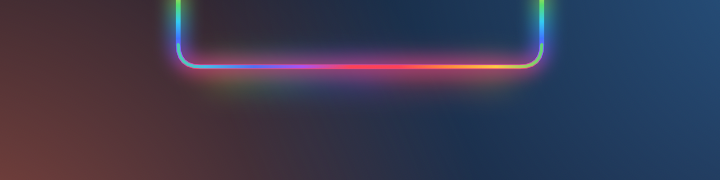
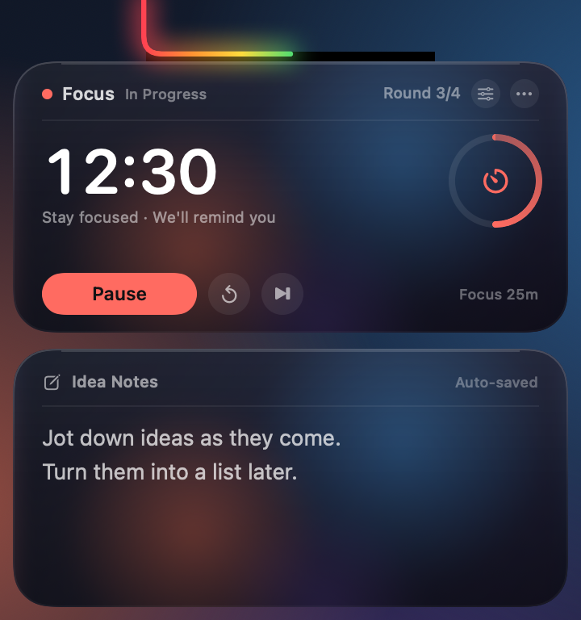
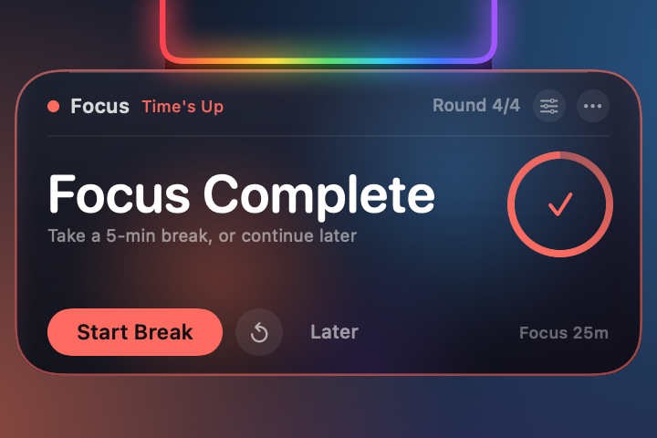
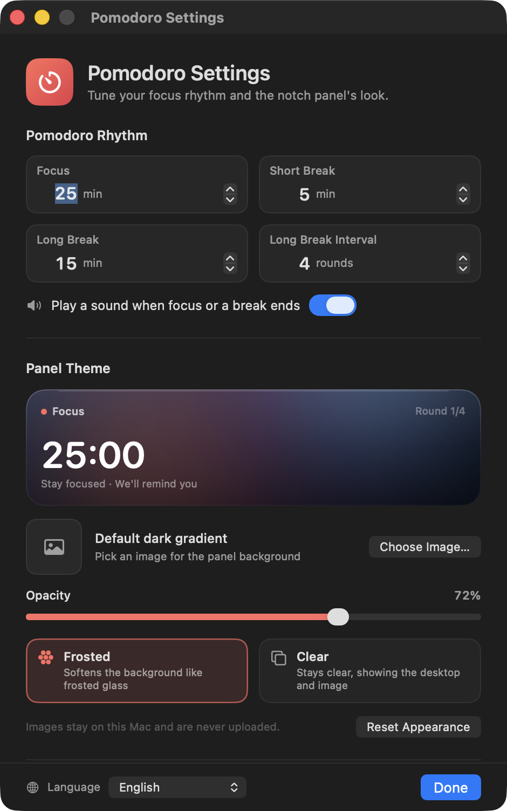

# Notch-Pomodoro + Ideennotizen

[English](README.md) · [简体中文](README.zh-CN.md) · [繁體中文](README.zh-TW.md) · [日本語](README.ja.md) · [한국어](README.ko.md) · [Español](README.es.md) · [Français](README.fr.md) · **Deutsch**

Ein Pomodoro-Timer und eine Schnellnotiz-Tafel, die auf der MacBook-Notch zu Hause ist. Der Regenbogen um die Notch wird während einer laufenden Einheit zum Countdown-Fortschrittsbalken.

> **Nur für MacBooks mit Notch.** Macs ohne Notch und externe Displays sind keine unterstützten Ziele.


[](LICENSE)

Im Leerlauf fließt ein Regenbogen um die linke, untere und rechte Kante der Notch. Startest du eine Fokus-Einheit oder eine Pause, wird der Regenbogen zum Fortschrittsbalken und füllt den U-förmigen Rand von links nach rechts. Fahr mit dem Zeiger auf die Notch, um sie auszuklappen: oben sitzt der Timer, darunter die Notiztafel. Endet eine Einheit, erscheint nur die Timer-Karte – die Notizen bleiben aus dem Weg.

## Kompatibilität

Diese App ist gezielt für **MacBooks mit Notch** gebaut, nicht als allgemeiner Menüleisten-Timer:

- 14/16-Zoll-MacBook Pro (M1 Pro und neuer) und 13/15-Zoll-MacBook Air (M2 und neuer)
- Getestet auf einem 14-Zoll-MacBook mit M4, logische Auflösung 1470×956, Notch-Breite 179 pt
- macOS 14 oder neuer
- Macs ohne Notch und externe Displays sind keine Zielumgebungen; es gibt eine Ersatzdarstellung, aber Layout und Größe sind nicht garantiert
- Die Binärdatei ist Universal (Apple Silicon + Intel), die eigentliche Zielhardware sind aber MacBooks mit Notch und Apple Silicon

**Leerlauf – der Regenbogen fließt um die Notch**



**Ausgeklappt – oben der Timer, unten die Ideennotizen**



**Einheit beendet – eine Erinnerung nur mit dem Timer**



> Die Screenshots verwenden Beispieldaten: Fokus `12:30` (etwa halber Fortschritt), Runde 3 heute und Beispieltext in der Notiz. Das Leerlauf-Bild zeigt den fließenden Regenbogen, bevor eine Einheit beginnt; im ausgeklappten Bild ist der Regenbogen zur Hälfte gefüllt – passend zum aktuellen Fokusfortschritt.

## Der Regenbogen ist der Fortschrittsbalken

- **Kein aktiver Countdown (bereit/Leerlauf)**: der ursprüngliche Regenbogen fließt weiter um alle drei Kanten
- **Fokus, kurze Pause oder lange Pause läuft**: der Regenbogen wird zum Fortschrittsbalken und füllt den U-förmigen Notch-Rand von links nach rechts
- **0 %**: überhaupt kein Regenbogen; **100 %**: der ganze U-förmige Rand leuchtet
- **Pausiert**: der Fortschrittsbalken bleibt an seiner aktuellen Position stehen
- **Fertig**: bleibt bei 100 % und pulsiert während der Erinnerung sanft
- **Zurücksetzen / Überspringen**: zurück zu Bereit, und der fließende Regenbogen kommt wieder
- Der Fortschritt wird aus der echten Endzeit berechnet und läuft daher fließend weiter, statt einmal pro Sekunde zu springen; er ist sowohl eingeklappt als auch ausgeklappt sichtbar

## Pomodoro

- Standard sind **25 Min. Fokus / 5 Min. kurze Pause / 15 Min. lange Pause**
- Eine lange Pause alle **4 Fokusrunden**; alle drei Dauern und das Intervall sind einstellbar
- Die große Zahl ist der aktuelle Countdown; der Ring rechts zeigt den Fortschritt der Runde
- **Fokus starten / pausieren / fortsetzen / diese Runde zurücksetzen / diese Runde überspringen**
- Die Kopfzeile zeigt die aktuelle Phase und wie viele Runden du heute geschafft hast; in Pausenphasen wechselt die Farbe zu Grün oder Blau
- Ein Systemton ertönt, wenn Fokus oder Pause endet (lässt sich abschalten)
- **⟳** setzt die Runde zurück; **⏭** überspringt sie. Das Überspringen von Fokus zählt nicht zu den heutigen Runden

### Erinnerung am Ende einer Einheit

- Das Panel klappt automatisch aus, aber **nur die Timer-Karte wird gezeigt**; die Notizkarte ist vorübergehend ausgeblendet
- Die Karte bekommt einen farbigen Rand, und der Regenbogen an der Notch pulsiert
- Nach beendetem Fokus erscheint „Fokus fertig“: starte die Pause direkt oder wähle **Später**
- Nach beendeter Pause erscheint „Pause vorbei“: starte den nächsten Fokus direkt
- Ohne Interaktion klappt die Erinnerung nach etwa 20 Sekunden ein; wenn du mit dem Zeiger auf der Karte bleibst, hältst du sie offen
- **Später** blendet nur die Erinnerung aus – der Status „Fertig“ bleibt erhalten, sodass die Karte beim nächsten Darüberfahren wieder erscheint
- Tippst du beim Timeout gerade eine Notiz, endet die Eingabe und die Erinnerung übernimmt, damit du sie nicht verpasst

## Ideennotizen

- Klicke in das Textfeld und tippe; mehrzeilige Eingabe, Scrollen, Rückgängig/Wiederholen und Kopieren/Einfügen werden unterstützt
- Speichert etwa 0,4 Sekunden nachdem du aufhörst zu tippen, mit „Automatisch gespeichert“ oben rechts
- Das Panel bleibt beim Tippen ausgeklappt; es klappt ein, sobald du auf eine andere App oder den Schreibtisch klickst
- Löschen über **⋯ → Notizen löschen…** (mit Bestätigung) oder im Einstellungsfenster
- Notizen werden getrennt von den Nutzungsdaten gespeichert; ein Zurücksetzen der Nutzungsstatistik löscht sie also nie

## Panel-Design

Öffne die Einstellungen über das **Zahnrad** auf der Timer-Karte oder über **⋯ → Darstellung & Timer…**.



- **Eigenes Bild**: wähle ein PNG-/JPEG-/HEIC-Bild. Es wird in den App-Datenordner kopiert und auf maximal 2400 px Kantenlänge skaliert, die Originaldatei bleibt also unberührt
- **Deckkraft**: 8 %–100 %, steuert, wie stark Bild bzw. Glas durchscheint; wählst du zum ersten Mal ein Bild, wird sie auf 80 % angehoben
- **Milchig**: eine integrierte weiche Glasschicht; eigene Bilder werden weichgezeichnet, als würdest du sie durch Milchglas sehen
- **Klar**: transparenter, Bilder bleiben scharf, und ohne eigenes Bild ist der Schreibtisch sichtbar
- Beide Stile legen eine dunkle Schutzschicht darüber, damit weißer Text auch auf hellem Hintergrund lesbar bleibt
- **Bild entfernen** / **Design zurücksetzen** stellen jederzeit die Standardwerte wieder her
- Bilder bleiben auf diesem Mac, werden nie hochgeladen und brauchen keine Berechtigung zur Bildschirmaufnahme

> Der milchige Modus nutzt eine integrierte weiche Schicht (plus ein weichgezeichnetes eigenes Bild) und zeichnet den Schreibtisch nicht auf. Der Klar-Modus zeigt den Schreibtisch oder das Bild direkt. Wenn du „meinen eigenen Schreibtisch, sanft unscharf“ willst, lege einen Schreibtisch-Screenshot oder ein Hintergrundbild als Design-Bild fest.

## Sprachen

Die Oberfläche ist in **8 Sprachen** verfügbar:

- Englisch
- 简体中文 (Vereinfachtes Chinesisch)
- 繁體中文 (Traditionelles Chinesisch)
- 日本語 (Japanisch)
- 한국어 (Koreanisch)
- Español (Spanisch)
- Français (Französisch)
- Deutsch

Wähle **System**, um der Sprache von macOS zu folgen, oder wähle eine Sprache manuell im Globus-Menü unten links im Einstellungsfenster. Änderungen wirken sofort auf Panel, Erinnerung, Kontextmenüs und Einstellungsfenster – ein Neustart ist nicht nötig. Auch der in Finder angezeigte Name folgt der Systemsprache.

## Verwendung

- **Ausklappen**: bewege den Zeiger auf die Notch oder auf den Regenbogenstreifen darunter; sie öffnet sich nach etwa 0,12 Sekunden
- **Offen halten**: wenn du in die Karte hineinfährst, bleibt sie offen; bloßes Darüberfahren stiehlt der aktuellen App nicht den Tastaturfokus
- **Timer-Tasten**: reagieren schon beim ersten Klick, ohne die App zu aktivieren oder deine Arbeit zu unterbrechen
- **Notiz schreiben**: ein Klick in den Notizbereich aktiviert die Eingabe; klicke danach auf eine andere App oder den Schreibtisch
- **Einklappen**: etwa 0,3 Sekunden nachdem der Zeiger die Karte verlässt; beim Tippen einer Notiz bleibt sie offen
- **Weiter-Menü**: klicke auf **⋯** in der Karte oder mache einen Rechtsklick auf die Timer-Karte
  - Starten / Pausieren / Fortsetzen
  - Diese Runde zurücksetzen, diese Runde überspringen
  - Darstellung & Timer-Einstellungen
  - Beim Anmelden öffnen
  - Notizen löschen
  - Datenordner öffnen
  - Nutzungsstatistik zurücksetzen
  - Beenden
- **Kurz einblenden**: doppelklicke die App erneut im Finder, und die Karte öffnet sich für etwa 4 Sekunden
- Funktioniert über Vollbild-Apps und verschiedene Spaces hinweg; die Karte bleibt oben auf dem Bildschirm und belegt keinen Platz im Dock

## Timer- und Erinnerungsregeln

- Der Pomodoro rechnet mit einer Endzeit, statt jede Sekunde eins zu addieren, und driftet deshalb nach einem Hänger oder einem kurzen Schlaf nicht merklich
- Ein abgeschlossener Fokus zählt für „heute“ und für den Zyklus der langen Pausen; eine abgeschlossene kurze Pause fügt keine Runde hinzu
- Nach einer langen Pause beginnt der Rundenzähler wieder bei 1
- Das Überspringen von Fokus fügt keine Runde hinzu; das Überspringen oder Abschließen einer langen Pause setzt den Zyklus zurück
- Die Fokusrunden von heute werden um lokale Mitternacht zurückgesetzt
- Der Countdown läuft durch Sperrbildschirm, Ruhezustand und App-Wechsel weiter; ist die Zeit um, erscheint die Erinnerung an der Notch
- Die Computer-Nutzungszeit wird weiterhin im Hintergrund erfasst (die ursprüngliche Funktion). Sie erscheint nicht mehr in der oberen Karte; siehe „heute / gesamt“ im Statusleisten- oder Kartenmenü

## Daten und Datenschutz

- Nutzungsdaten: `~/Library/Application Support/UsageClock/usage.json`
- Notizen: `~/Library/Application Support/UsageClock/memo.txt` (automatisches Speichern etwa 0,4 s nach dem Tippen)
- Design-Bild: `~/Library/Application Support/UsageClock/theme-image.png` (optional)
- Pomodoro- und Design-Einstellungen: System-`UserDefaults` (`com.dumaster.usageclock`)
- Die Nutzung wird etwa alle 20 Sekunden, beim Sperren/Ruhezustand und beim Beenden gespeichert
- Kein Tracking pro App, keine weiteren gesammelten Informationen und keine Netzwerkanfragen
- Nutzung zurücksetzen / Notizen löschen / Design-Bild entfernen lassen sich nicht rückgängig machen

## Download

Lade die neueste `UsageClock.zip` von [GitHub Releases](https://github.com/liutongqi0-star/notch-pomodoro/releases/latest) herunter, entpacke sie und ziehe `UsageClock.app` in den Ordner „Programme“. Meldet macOS beim ersten Start, dass der Entwickler nicht verifiziert werden kann, mache einen Rechtsklick auf die App → **Öffnen**.

Du kannst die App auch aus dem Quellcode bauen (siehe unten).

## Installation

```bash
git clone https://github.com/liutongqi0-star/notch-pomodoro.git
cd notch-pomodoro
./install.sh
```

Das Installationsskript:

- kopiert `UsageClock.app` nach `~/Applications/` (aktueller Benutzer, kein Admin-Passwort)
- legt einen Anmeldeeintrag unter `~/Library/LaunchAgents/com.dumaster.usageclock.plist` an, damit die App beim Anmelden startet
- startet die App sofort

Sobald die App läuft, fließt der Regenbogen um die Notch; fahre darüber, um Timer und Notizen zu sehen.

## Deinstallation

```bash
./uninstall.sh          # asks whether to delete recorded data
./uninstall.sh --purge  # also deletes recorded data
```

Oder entferne sie manuell:

```bash
rm -rf ~/Applications/UsageClock.app
rm -f ~/Library/LaunchAgents/com.dumaster.usageclock.plist
rm -rf "$HOME/Library/Application Support/UsageClock"   # optional: usage, notes, theme image
```

## Aus dem Quellcode bauen

Voraussetzungen: macOS 14 oder neuer, Xcode / Command Line Tools.

```bash
cd notch-pomodoro
./build.sh
```

Das Skript kompiliert mit `swiftc` eine Universal-Binärdatei (Apple Silicon + Intel), erzeugt das Tomaten-Icon, wendet eine Ad-hoc-Signatur an und erstellt diese Ausgabe:

- `UsageClock.app`
- `build/UsageClock.zip`

Um die Panel-Komponenten ohne Fenster zu rendern (für Assets oder zum Debuggen):

```bash
mkdir -p /tmp/usageclock-preview
USAGECLOCK_RENDER_PREVIEW=1 \
USAGECLOCK_LANGUAGE=en \
USAGECLOCK_DATA_DIR=/tmp/usageclock-preview \
USAGECLOCK_AGENT_DIR=/tmp/usageclock-preview \
USAGECLOCK_PREVIEW_DIR=/tmp/usageclock-preview \
./UsageClock.app/Contents/MacOS/UsageClock
```

Das erzeugt:

- `preview-cap.png`: der dreiseitige Regenbogen
- `preview-body.png`: der ausgeklappte Timer + die Notizen
- `preview-reminder.png`: die Erinnerung nur mit Timer

Die UI-Übersetzungen liegen in `Localization/*.json`; nach dem Bearbeiten führst du `python3 Tools/generate_localization.py` aus, um `Sources/L10nCatalog.swift` neu zu erzeugen.

## Projektstruktur

```
UsageClock/
├── Sources/
│   ├── main.swift                  # entry point (+ offline preview rendering)
│   ├── AppDelegate.swift           # lifecycle, settings window, completion notifications
│   ├── AppModel.swift              # usage tracking, state detection, persistence
│   ├── PomodoroEngine.swift        # timer state machine, durations, long-break cycle
│   ├── PomodoroCard.swift          # top timer card
│   ├── Localization.swift          # language selection, lookup, runtime switching
│   ├── L10nCatalog.swift           # generated translation tables
│   ├── ThemeModel.swift            # theme image, opacity, glass style
│   ├── ThemeView.swift             # card background, glass layers, settings preview
│   ├── SettingsView.swift          # settings window content
│   ├── SettingsWindowController.swift
│   ├── UsageStore.swift            # usage JSON
│   ├── LoginItem.swift             # login item (LaunchAgent)
│   ├── TimeFormat.swift            # duration/countdown formatting
│   ├── MemoStore.swift             # memo persistence
│   ├── MemoEditor.swift            # native multiline editor
│   ├── NotchGeometry.swift         # notch position / panel sizes / hit areas
│   ├── NotchView.swift             # rainbow, expanded card, animation
│   ├── NotchInteractionView.swift  # hover / button clicks / context menu
│   ├── NotchController.swift       # panels, expand/collapse, reminder state, menu
│   └── StatusBarController.swift   # menu bar (secondary entry point)
├── Localization/                   # en, zh-Hans, zh-Hant, ja, ko, es, fr, de
├── Resources/                      # localized InfoPlist.strings
├── Tools/
│   ├── MakeIcon.swift              # app icon generator
│   ├── WindowID.swift              # debug helper: list window IDs
│   └── generate_localization.py    # validates JSON and generates L10nCatalog.swift
├── docs/                           # screenshots (docs/en for English)
├── Info.plist
├── build.sh
├── install.sh
└── uninstall.sh
```

## FAQ

**Kein Regenbogen an der Notch?**
Stelle sicher, dass die App läuft (`pgrep -x UsageClock`). Hat dieser Mac keine Notch oder nutzt du hauptsächlich ein externes Display, zeichnet die App eine schwarze Notch-Form samt Regenbogen oben in der Mitte des aktuellen Hauptbildschirms; auch dort klappt sie beim Darüberfahren aus.

**Warum leuchtet nur ein Teil des Regenbogens?**
Das ist der aktuelle Countdown-Fortschritt: 0 % zeigt nichts, 100 % lässt den ganzen U-förmigen Rand leuchten. Er erreicht 100 %, wenn Fokus bzw. Pause endet; der vollständig fließende Regenbogen gehört zum Leerlaufzustand.

**Die Erinnerung war schnell weg.**
Sie klappt nach etwa 20 Sekunden ohne Interaktion ein; wenn du mit dem Zeiger auf der Karte bleibst, bleibt sie offen. Auch **Später** blendet sie aus, aber der Status „Fertig“ bleibt bestehen – fahre erneut über die Notch, um die Karte zu sehen und die nächste Phase zu starten.

**Warum verwischt Milchglas meinen Schreibtisch nicht?**
Der milchige Modus nutzt eine integrierte weiche Schicht und ein weichgezeichnetes eigenes Bild; er liest den Schreibtisch nicht, daher ist keine Berechtigung zur Bildschirmaufnahme nötig. Der Klar-Modus zeigt den Schreibtisch direkt. Für „meinen eigenen Schreibtisch, sanft unscharf“ lädst du einen Schreibtisch-Screenshot oder ein Hintergrundbild als Design-Bild.

**Text ist auf klarem Glas schwer zu lesen.**
Der Klar-Modus ist transparenter; erhöhe die **Deckkraft**, wechsle zu Milchig oder nutze ein Bild-Design. Das Einstellungsfenster zeigt eine Live-Vorschau.

**Klappt das Notiz-Panel automatisch ein?**
Nein. Sobald du in die Notiz klickst und zu tippen beginnst, bleibt das Panel offen, bis du auf eine andere App oder den Schreibtisch klickst. Wenn du nur zum Schauen darüberfährst, klappt es etwa 0,3 Sekunden nach dem Verlassen wieder ein.

**Wo werden Notizen und Design-Bilder gespeichert?**
`memo.txt` und `theme-image.png` unter `~/Library/Application Support/UsageClock/`. Notizen löschst du mit ⋯ → Notizen löschen; das Design-Bild entfernst du in den Einstellungen.

**Wo ist die alte Gesamtnutzungszeit hin?**
Die obere Karte ist jetzt der Pomodoro-Timer; die Computer-Nutzung wird weiterhin im Hintergrund erfasst. Öffne das ⋯-Menü oder das Statusleisten-Menü, um „heute / gesamt“ zu sehen, oder setze die Nutzungsstatistik zurück.

**Das Menüleisten-Symbol ist unsichtbar.**
Auf Macs mit Notch kann macOS Statusobjekte unter der Notch verstecken, wenn die Menüleiste voll ist. Das betrifft die App nicht: Der Regenbogen an der Notch und das Panel beim Darüberfahren sind die eigentliche Oberfläche. Entferne ein paar selten genutzte Menüleisten-Elemente, um das Symbol zurückzuholen.

**„Beim Anmelden öffnen“ funktioniert nicht.**
Prüfe, ob `~/Library/LaunchAgents/com.dumaster.usageclock.plist` existiert. Wenn du die App manuell verschoben hast, starte sie einmal, damit sie den Pfad aktualisieren kann. Du kannst „Beim Anmelden öffnen“ auch im ⋯-Menü aus- und wieder einschalten.

**„Entwickler kann nicht verifiziert werden“ beim ersten Start.**
Die App ist lokal ad-hoc signiert. Mache im Finder einen Rechtsklick auf `UsageClock.app` → **Öffnen**, oder führe aus:

```bash
xattr -dr com.apple.quarantine ~/Applications/UsageClock.app
```

---

Aktuelle Version: **3.2.0 (Build 12)**

Repository: <https://github.com/liutongqi0-star/notch-pomodoro>

## Lizenz

MIT-Lizenz. Siehe [LICENSE](LICENSE).
