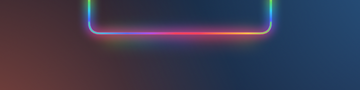
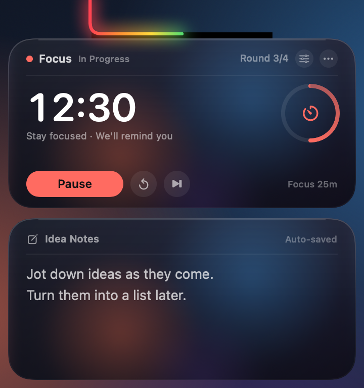
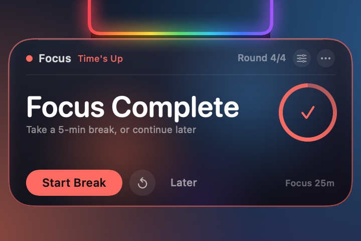
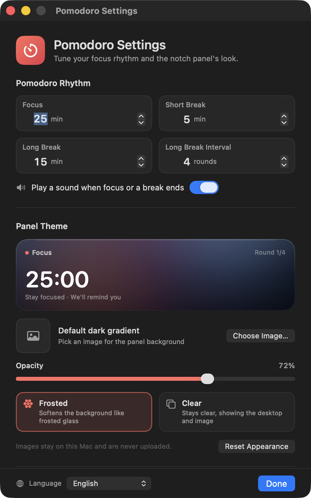

# Pomodoro de la muesca + notas de ideas

[English](README.md) · [简体中文](README.zh-CN.md) · [繁體中文](README.zh-TW.md) · [日本語](README.ja.md) · [한국어](README.ko.md) · **Español** · [Français](README.fr.md) · [Deutsch](README.de.md)

Un temporizador Pomodoro y un bloc de notas rápidas que vive en la muesca del MacBook. El arcoíris que rodea la muesca se convierte en una barra de progreso de cuenta atrás mientras hay una sesión en curso.

> **Solo para MacBook con muesca.** Los Mac sin muesca y las pantallas externas no son entornos compatibles.


[](LICENSE)

Cuando está inactivo, un arcoíris fluye por los bordes izquierdo, inferior y derecho de la muesca. Inicia una sesión de enfoque o un descanso y el arcoíris se convierte en una barra de progreso que llena el borde en forma de U de izquierda a derecha. Pasa el puntero por la muesca para expandirla: arriba está el temporizador y abajo el bloc de notas. Cuando termina una sesión, solo aparece la tarjeta del temporizador: las notas se quedan al margen.

## Compatibilidad

Esta app está pensada específicamente para **MacBook con muesca**, no como un temporizador genérico de la barra de menús:

- MacBook Pro de 14/16 pulgadas (M1 Pro y posteriores) y MacBook Air de 13/15 pulgadas (M2 y posteriores)
- Probada en un MacBook de 14 pulgadas con M4, resolución lógica de 1470×956 y una muesca de 179 pt de ancho
- macOS 14 o posterior
- Los Mac sin muesca y las pantallas externas no son entornos objetivo; existe un dibujo de reserva, pero no se garantizan el diseño ni el tamaño
- El binario es Universal (Apple Silicon + Intel), pero el hardware previsto son los MacBook con muesca y Apple Silicon

**Inactivo: el arcoíris fluye alrededor de la muesca**



**Expandido: el temporizador arriba y las notas de ideas abajo**



**Sesión terminada: un recordatorio solo con el temporizador**



> Las capturas usan datos de ejemplo: enfoque de `12:30` (más o menos la mitad del progreso), ronda 3 de hoy y un texto de nota de ejemplo. La imagen de inactividad muestra el arcoíris en movimiento antes de que empiece una sesión; en la imagen expandida el arcoíris está lleno hasta la mitad, en consonancia con el progreso del enfoque actual.

## El arcoíris es la barra de progreso

- **Sin cuenta atrás activa (listo/inactivo)**: el arcoíris original sigue fluyendo por los tres bordes
- **Enfoque, descanso corto o descanso largo en curso**: el arcoíris se convierte en una barra de progreso que llena el borde en forma de U de la muesca de izquierda a derecha
- **0 %**: no hay arcoíris; **100 %**: todo el borde en forma de U está iluminado
- **En pausa**: la barra de progreso se congela en su posición actual
- **Completado**: se queda en el 100 % y pulsa suavemente durante el recordatorio
- **Restablecer / saltar**: vuelve a listo y el arcoíris en movimiento reaparece
- El progreso se calcula a partir de la hora de fin real, así que avanza de forma fluida en vez de dar un salto cada segundo; se ve tanto contraído como expandido

## Pomodoro

- Por defecto: **25 min de enfoque / 5 min de descanso corto / 15 min de descanso largo**
- Un descanso largo cada **4 rondas de enfoque**; las tres duraciones y el intervalo se pueden configurar
- El número grande es la cuenta atrás actual; el anillo de la derecha muestra el progreso de la ronda
- **Iniciar enfoque / pausar / reanudar / restablecer esta ronda / saltar esta ronda**
- La cabecera muestra la fase actual y cuántas rondas has completado hoy; las fases de descanso cambian a verde o azul
- Suena un sonido del sistema cuando termina el enfoque o un descanso (se puede desactivar)
- **⟳** restablece la ronda; **⏭** la salta. Saltar el enfoque no cuenta para las rondas de hoy

### Recordatorio al terminar la sesión

- El panel se expande automáticamente, pero **solo se muestra la tarjeta del temporizador**; la tarjeta de notas se oculta temporalmente
- La tarjeta recibe un borde de color y el arcoíris de la muesca pulsa
- Al terminar el enfoque aparece «Enfoque completado»: empieza el descanso ahora mismo o elige **Más tarde**
- Al terminar el descanso aparece «Descanso terminado»: empieza ya el siguiente enfoque
- Si no interactúas, el recordatorio se contrae a los 20 segundos, aproximadamente; si pasas el puntero por la tarjeta, se mantiene abierto
- **Más tarde** solo descarta el recordatorio: el estado completado se conserva, así que al pasar el puntero por la muesca más tarde la tarjeta vuelve a aparecer
- Si estás escribiendo una nota cuando se acaba el tiempo, la entrada termina y el recordatorio toma el relevo para que no se te pase

## Notas de ideas

- Haz clic en el área de texto y escribe; admite varias líneas, desplazamiento, deshacer/rehacer y copiar/pegar
- Se guarda unos 0,4 segundos después de que dejes de escribir, con «Guardado automático» en la esquina superior derecha
- El panel permanece expandido mientras escribes; se contrae cuando haces clic en otra app o en el escritorio
- Bórralo desde **⋯ → Borrar notas…** (con confirmación) o desde la ventana de ajustes
- Las notas se guardan aparte de los datos de uso, así que restablecer las estadísticas de uso nunca las borra

## Temas del panel

Abre los ajustes desde el **engranaje** de la tarjeta del temporizador o desde **⋯ → Apariencia y temporizador…**.



- **Imagen personalizada**: elige una imagen PNG / JPEG / HEIC. Se copia a la carpeta de datos de la app y se redimensiona a un máximo de 2400 px de lado, así que el archivo original no se toca
- **Opacidad**: 8 %–100 %, controla cuánto se deja ver la imagen o el cristal; la primera vez que eliges una imagen sube al 80 %
- **Esmerilado**: una capa de cristal suave integrada; las imágenes personalizadas se suavizan como si se vieran a través de un cristal esmerilado
- **Transparente**: más transparente, mantiene las imágenes nítidas y muestra el escritorio cuando no hay imagen
- Ambos estilos añaden una capa oscura de protección para que el texto blanco siga siendo legible sobre fondos claros
- **Quitar imagen** / **Restablecer apariencia** restauran los valores predeterminados en cualquier momento
- Las imágenes se quedan en este Mac, nunca se suben y no necesitan permiso de grabación de pantalla

> El modo Esmerilado usa una capa suave integrada (más una imagen personalizada suavizada) y no captura el escritorio. El modo Transparente muestra el escritorio o la imagen directamente. Si quieres «mi propio escritorio, suavemente desenfocado», pon una captura del escritorio o un fondo de pantalla como imagen del tema.

## Idiomas

La interfaz está disponible en **8 idiomas**:

- English
- 简体中文 (chino simplificado)
- 繁體中文 (chino tradicional)
- 日本語 (japonés)
- 한국어 (coreano)
- Español (español)
- Français (francés)
- Deutsch (alemán)

Elige **Sistema** para seguir el idioma de macOS, o escoge un idioma manualmente en el menú del globo de la esquina inferior izquierda de la ventana de ajustes. Los cambios se aplican al instante en el panel, el recordatorio, los menús contextuales y la ventana de ajustes, sin reiniciar. El nombre que aparece en Finder también sigue el idioma del sistema.

## Uso

- **Expandir**: mueve el puntero a la muesca o a la franja de arcoíris que hay justo debajo; se abre tras unos 0,12 segundos
- **Mantener abierto**: si entras en la tarjeta, se mantiene abierta; pasar el puntero por encima no le roba el foco del teclado a la app actual
- **Botones del temporizador**: responden con el primer clic sin activar la app ni interrumpir tu trabajo
- **Escribir una nota**: al hacer clic en el área de notas se activa la entrada; cuando termines, haz clic en otra app o en el escritorio
- **Contraer**: unos 0,3 segundos después de que el puntero salga de la tarjeta; sigue abierto mientras escribes una nota
- **Menú Más**: haz clic en **⋯** de la tarjeta o haz clic derecho en la tarjeta del temporizador
  - Iniciar / pausar / reanudar
  - Restablecer esta ronda, saltar esta ronda
  - Apariencia y temporizador
  - Abrir al iniciar sesión
  - Borrar notas
  - Abrir carpeta de datos
  - Restablecer estadísticas de uso
  - Salir
- **Mostrar temporalmente**: vuelve a hacer doble clic en la app desde Finder y la tarjeta se abre unos 4 segundos
- Funciona en apps a pantalla completa y en distintos espacios; la tarjeta se queda en la parte superior de la pantalla y no ocupa espacio en el Dock

## Reglas del temporizador y los recordatorios

- El Pomodoro usa una hora de fin en lugar de ir sumando un segundo cada vez, así que no se desvía de forma apreciable después de un bloqueo o de una suspensión breve
- Terminar el enfoque cuenta para «hoy» y para el ciclo de descanso largo; terminar un descanso corto no suma una ronda
- Después de un descanso largo, el contador de rondas vuelve a empezar en 1
- Saltar el enfoque no suma una ronda; saltar o completar un descanso largo reinicia el ciclo
- Las rondas de enfoque de hoy se reinician a la medianoche local
- La cuenta atrás sigue corriendo durante el bloqueo de pantalla, la suspensión y el cambio de app; el recordatorio aparece en la muesca cuando se acaba el tiempo
- El tiempo de uso del ordenador se sigue registrando en segundo plano (la función original). Ya no se muestra en la tarjeta superior; consulta «uso de hoy / total» en la barra de menús o en el menú de la tarjeta

## Datos y privacidad

- Datos de uso: `~/Library/Application Support/UsageClock/usage.json`
- Notas: `~/Library/Application Support/UsageClock/memo.txt` (guardado automático unos 0,4 s después de escribir)
- Imagen del tema: `~/Library/Application Support/UsageClock/theme-image.png` (opcional)
- Ajustes del Pomodoro y del tema: `UserDefaults` del sistema (`com.dumaster.usageclock`)
- El uso se guarda cada 20 segundos aproximadamente, al bloquear/dormir y al salir
- Sin seguimiento por app, sin recopilar ninguna otra información y sin peticiones de red
- Restablecer el uso, borrar las notas o quitar la imagen del tema no se pueden deshacer

## Descarga

Descarga el `UsageClock.zip` más reciente desde [GitHub Releases](https://github.com/liutongqi0-star/notch-pomodoro/releases/latest), descomprímelo y arrastra `UsageClock.app` a Aplicaciones. Si en el primer inicio macOS avisa de que no puede verificar al desarrollador, haz clic derecho en la app → **Abrir**.

También puedes compilarlo desde el código fuente (ver más abajo).

## Instalación

```bash
git clone https://github.com/liutongqi0-star/notch-pomodoro.git
cd notch-pomodoro
./install.sh
```

El script de instalación:

- copia `UsageClock.app` a `~/Applications/` (usuario actual, sin contraseña de administrador)
- escribe un elemento de inicio de sesión en `~/Library/LaunchAgents/com.dumaster.usageclock.plist` para abrir la app al iniciar sesión
- inicia la app de inmediato

Una vez en marcha, el arcoíris fluye alrededor de la muesca; pasa el puntero por encima para ver el temporizador y las notas.

## Desinstalación

```bash
./uninstall.sh          # asks whether to delete recorded data
./uninstall.sh --purge  # also deletes recorded data
```

O quítalo manualmente:

```bash
rm -rf ~/Applications/UsageClock.app
rm -f ~/Library/LaunchAgents/com.dumaster.usageclock.plist
rm -rf "$HOME/Library/Application Support/UsageClock"   # optional: usage, notes, theme image
```

## Compilar desde el código fuente

Requisitos: macOS 14 o posterior, Xcode / Command Line Tools.

```bash
cd notch-pomodoro
./build.sh
```

El script compila un binario Universal (Apple Silicon + Intel) con `swiftc`, genera el icono de tomate, aplica una firma ad-hoc y produce:

- `UsageClock.app`
- `build/UsageClock.zip`

Para renderizar los componentes del panel sin mostrar ventanas (para recursos o depuración):

```bash
mkdir -p /tmp/usageclock-preview
USAGECLOCK_RENDER_PREVIEW=1 \
USAGECLOCK_LANGUAGE=en \
USAGECLOCK_DATA_DIR=/tmp/usageclock-preview \
USAGECLOCK_AGENT_DIR=/tmp/usageclock-preview \
USAGECLOCK_PREVIEW_DIR=/tmp/usageclock-preview \
./UsageClock.app/Contents/MacOS/UsageClock
```

Esto produce:

- `preview-cap.png`: el arcoíris de tres lados
- `preview-body.png`: el temporizador expandido + las notas
- `preview-reminder.png`: el recordatorio solo con el temporizador

Las traducciones de la interfaz están en `Localization/*.json`; después de editarlas, ejecuta `python3 Tools/generate_localization.py` para regenerar `Sources/L10nCatalog.swift`.

## Estructura del proyecto

```
UsageClock/
├── Sources/
│   ├── main.swift                  # entry point (+ offline preview rendering)
│   ├── AppDelegate.swift           # lifecycle, settings window, completion notifications
│   ├── AppModel.swift              # usage tracking, state detection, persistence
│   ├── PomodoroEngine.swift        # timer state machine, durations, long-break cycle
│   ├── PomodoroCard.swift          # top timer card
│   ├── Localization.swift          # language selection, lookup, runtime switching
│   ├── L10nCatalog.swift           # generated translation tables
│   ├── ThemeModel.swift            # theme image, opacity, glass style
│   ├── ThemeView.swift             # card background, glass layers, settings preview
│   ├── SettingsView.swift          # settings window content
│   ├── SettingsWindowController.swift
│   ├── UsageStore.swift            # usage JSON
│   ├── LoginItem.swift             # login item (LaunchAgent)
│   ├── TimeFormat.swift            # duration/countdown formatting
│   ├── MemoStore.swift             # memo persistence
│   ├── MemoEditor.swift            # native multiline editor
│   ├── NotchGeometry.swift         # notch position / panel sizes / hit areas
│   ├── NotchView.swift             # rainbow, expanded card, animation
│   ├── NotchInteractionView.swift  # hover / button clicks / context menu
│   ├── NotchController.swift       # panels, expand/collapse, reminder state, menu
│   └── StatusBarController.swift   # menu bar (secondary entry point)
├── Localization/                   # en, zh-Hans, zh-Hant, ja, ko, es, fr, de
├── Resources/                      # localized InfoPlist.strings
├── Tools/
│   ├── MakeIcon.swift              # app icon generator
│   ├── WindowID.swift              # debug helper: list window IDs
│   └── generate_localization.py    # validates JSON and generates L10nCatalog.swift
├── docs/                           # screenshots (docs/en for English)
├── Info.plist
├── build.sh
├── install.sh
└── uninstall.sh
```

## Preguntas frecuentes

**¿No hay arcoíris en la muesca?**
Asegúrate de que la app se está ejecutando (`pgrep -x UsageClock`). Si este Mac no tiene muesca, o si usas sobre todo una pantalla externa, la app dibuja una forma de muesca negra y un arcoíris en el centro superior de la pantalla principal actual; pasar el puntero sigue expandiéndola.

**¿Por qué solo está iluminada una parte del arcoíris?**
Ese es el progreso actual de la cuenta atrás: el 0 % no muestra nada y el 100 % ilumina todo el borde en forma de U. Llega al 100 % cuando termina el enfoque o el descanso; el arcoíris completo en movimiento corresponde al estado inactivo.

**El recordatorio desapareció muy rápido.**
Se contrae a los 20 segundos sin interacción; si pasas el puntero por la tarjeta, se mantiene abierto. **Más tarde** también lo descarta, pero el estado completado permanece: pasa el puntero por la muesca otra vez para ver la tarjeta y empezar la siguiente fase.

**¿Por qué el cristal esmerilado no desenfoca mi escritorio?**
El modo Esmerilado usa una capa suave integrada y una imagen personalizada suavizada; no lee el escritorio, así que no hace falta permiso de grabación de pantalla. El modo Transparente muestra el escritorio directamente. Para «mi propio escritorio, suavemente desenfocado», sube una captura del escritorio o un fondo de pantalla como imagen del tema.

**Cuesta leer el texto sobre cristal transparente.**
El modo Transparente es más transparente; sube la **Opacidad**, cambia a Esmerilado o usa un tema con imagen. La ventana de ajustes tiene una vista previa en vivo.

**¿El panel de notas se contrae automáticamente?**
No. Cuando haces clic en las notas y empiezas a escribir, el panel sigue abierto hasta que haces clic en otra app o en el escritorio. Si solo pasas el puntero para mirar, se contrae unos 0,3 segundos después de que el puntero salga.

**¿Dónde se guardan las notas y las imágenes del tema?**
`memo.txt` y `theme-image.png` en `~/Library/Application Support/UsageClock/`. Borra las notas con ⋯ → Borrar notas; quita la imagen del tema en los ajustes.

**¿Dónde ha ido el antiguo tiempo de uso total?**
La tarjeta superior ahora es el temporizador Pomodoro; el uso del ordenador se sigue registrando en segundo plano. Abre el menú ⋯ o el de la barra de menús para ver «uso de hoy / total», o restablece las estadísticas de uso.

**El icono de la barra de menús no se ve.**
En los Mac con muesca, macOS puede ocultar los elementos de estado bajo la muesca cuando la barra de menús está llena. No afecta a la app: el arcoíris de la muesca y el panel al pasar el puntero son la interfaz principal. Quita algunos elementos de la barra de menús que uses menos para que vuelva.

**Abrir al iniciar sesión no funciona.**
Comprueba que existe `~/Library/LaunchAgents/com.dumaster.usageclock.plist`. Si moviste la app a mano, ábrela una vez para que pueda actualizar la ruta. También puedes desactivar y volver a activar «Abrir al iniciar sesión» en el menú ⋯.

**«No se puede verificar al desarrollador» en el primer inicio.**
La app está firmada ad-hoc localmente. Haz clic derecho en `UsageClock.app` en Finder → **Abrir**, o ejecuta:

```bash
xattr -dr com.apple.quarantine ~/Applications/UsageClock.app
```

---

Versión actual: **3.2.0 (build 12)**

Repositorio: <https://github.com/liutongqi0-star/notch-pomodoro>

## Licencia

Licencia MIT. Consulta [LICENSE](LICENSE).
