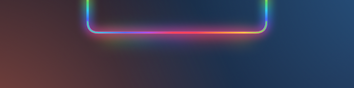
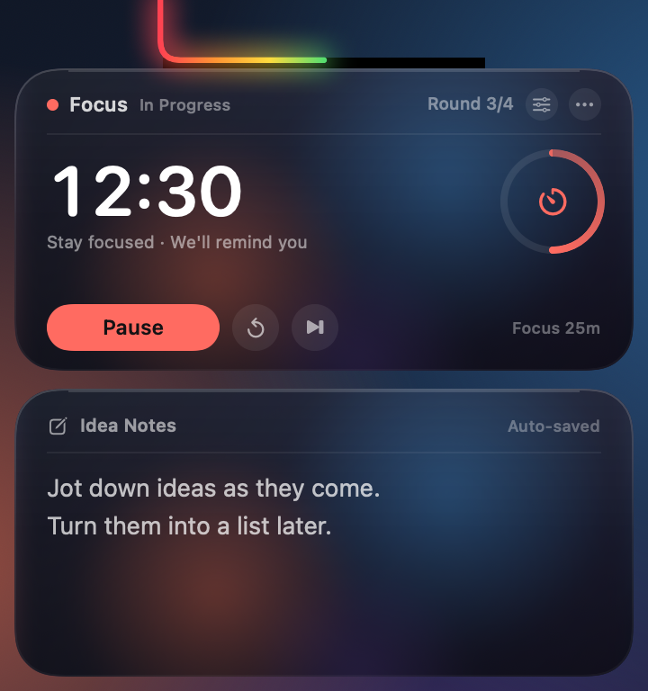
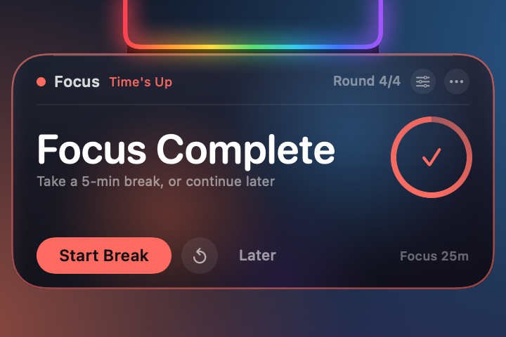
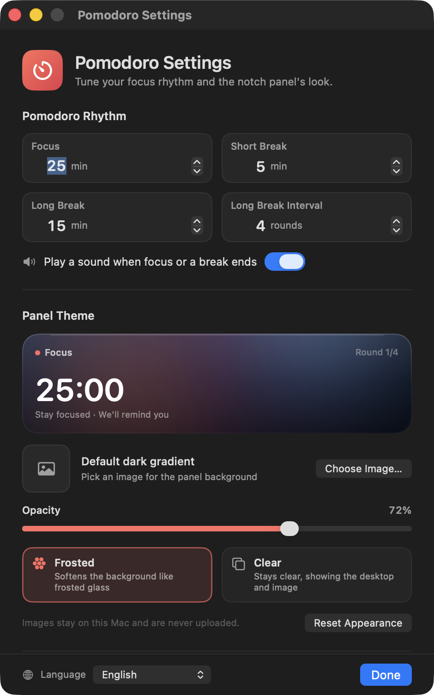

# Pomodoro d'encoche + Notes d'idées

[English](README.md) · [简体中文](README.zh-CN.md) · [繁體中文](README.zh-TW.md) · [日本語](README.ja.md) · [한국어](README.ko.md) · [Español](README.es.md) · **Français** · [Deutsch](README.de.md)

Un minuteur Pomodoro et un tableau de notes rapides qui se logent sur l'encoche du MacBook. L'arc-en-ciel autour de l'encoche se transforme en barre de progression décomptant la session en cours.

> **Uniquement pour les MacBook à encoche.** Les Mac sans encoche et les écrans externes ne font pas partie des cibles prises en charge.


[](LICENSE)

Au repos, un arc-en-ciel défile autour des bords gauche, inférieur et droit de l'encoche. Lancez une session de concentration ou une pause : l'arc-en-ciel devient une barre de progression qui remplit le rebord en U de gauche à droite. Survolez l'encoche pour la déplier : le minuteur s'affiche au-dessus, un tableau de notes en dessous. À la fin d'une session, seule la carte du minuteur apparaît — les notes restent à l'écart.

## Compatibilité

Cette app est conçue spécifiquement pour les **MacBook à encoche**, et non comme un minuteur générique de barre des menus :

- MacBook Pro 14/16 pouces (M1 Pro et ultérieurs) et MacBook Air 13/15 pouces (M2 et ultérieurs)
- Testé sur un MacBook 14 pouces équipé d'une puce M4, résolution logique 1470×956, largeur d'encoche de 179 pt
- macOS 14 ou ultérieur
- Les Mac sans encoche et les écrans externes ne sont pas des environnements cibles ; un tracé de repli existe, mais la disposition et les dimensions ne sont pas garanties
- Le binaire est Universal (Apple Silicon + Intel), mais le matériel visé est bien les MacBook Apple Silicon à encoche

**Au repos — l'arc-en-ciel défile autour de l'encoche**



**Déplié — le minuteur au-dessus, les notes d'idées en dessous**



**Session terminée — un rappel limité au minuteur**



> Les captures d'écran utilisent des données d'exemple : concentration `12:30` (environ à mi-parcours), tour 3 aujourd'hui et un texte de note d'exemple. L'image au repos montre l'arc-en-ciel fluide avant le début d'une session ; sur l'image dépliée, l'arc-en-ciel est rempli à moitié, ce qui correspond à la progression actuelle de la concentration.

## L'arc-en-ciel est la barre de progression

- **Aucun décompte actif (prêt/repos)** : l'arc-en-ciel d'origine continue de défiler sur les trois bords
- **Concentration, pause courte ou pause longue en cours** : l'arc-en-ciel devient une barre de progression qui remplit le rebord en U de l'encoche de gauche à droite
- **0 %** : aucun arc-en-ciel ; **100 %** : tout le rebord en U est allumé
- **En pause** : la barre de progression se fige à sa position actuelle
- **Terminé** : reste à 100 % et pulse doucement pendant le rappel
- **Réinitialiser / passer** : retour à l'état prêt, et l'arc-en-ciel fluide revient
- La progression est calculée à partir de l'heure de fin réelle : elle évolue donc de façon fluide au lieu de sauter une fois par seconde, et elle est visible aussi bien repliée que dépliée

## Pomodoro

- Par défaut : **25 min de concentration / 5 min de pause courte / 15 min de pause longue**
- Une pause longue tous les **4 tours de concentration** ; les trois durées et l'intervalle sont configurables
- Le grand nombre est le décompte en cours ; l'anneau de droite montre la progression du tour
- **Se concentrer / pause / reprendre / réinitialiser ce tour / passer ce tour**
- L'en-tête indique la phase en cours et le nombre de tours terminés aujourd'hui ; les phases de pause passent au vert ou au bleu
- Un son système est joué à la fin de la concentration ou d'une pause (désactivable)
- **⟳** réinitialise le tour ; **⏭** le passe. Passer une concentration ne compte pas dans les tours du jour

### Rappel de fin de session

- Le panneau se déplie automatiquement, mais **seule la carte du minuteur est affichée** ; la carte des notes est temporairement masquée
- La carte reçoit une bordure colorée et l'arc-en-ciel de l'encoche pulse
- À la fin d'une concentration, la carte affiche « Fin de concentration » : lancez la pause tout de suite ou choisissez **Plus tard**
- À la fin d'une pause, elle affiche « Fin de pause » : lancez la concentration suivante tout de suite
- Sans interaction, le rappel se replie au bout d'environ 20 secondes ; maintenir le pointeur sur la carte le garde ouvert
- **Plus tard** ne fait que fermer le rappel — l'état terminé est conservé, si bien qu'un survol ultérieur de l'encoche réaffiche la carte
- Si vous êtes en train d'écrire une note à l'échéance, la saisie s'arrête et le rappel prend le relais pour que vous ne le manquiez pas

## Notes d'idées

- Cliquez dans la zone de texte et écrivez ; prise en charge de plusieurs lignes, du défilement, de l'annulation/rétablissement et du copier/coller
- Enregistrement environ 0,4 seconde après l'arrêt de la frappe, avec « Enregistré automatiquement » dans le coin supérieur droit
- Le panneau reste déplié pendant la saisie ; il se replie après un clic sur une autre app ou sur le bureau
- Effacez-les depuis **⋯ → Effacer les notes…** (avec confirmation) ou depuis la fenêtre de réglages
- Les notes sont stockées séparément des données d'utilisation : réinitialiser les statistiques d'utilisation ne les supprime jamais

## Thèmes du panneau

Ouvrez les réglages depuis l'icône **engrenage** de la carte du minuteur, ou **⋯ → Apparence et minuteur…**.



- **Image personnalisée** : choisissez une image PNG / JPEG / HEIC. Elle est copiée dans le dossier de données de l'app et redimensionnée à 2400 px de côté maximum, le fichier d'origine n'est donc pas modifié
- **Opacité** : 8 % – 100 %, contrôle la transparence de l'image ou du verre ; choisir une image pour la première fois fait passer l'opacité à 80 %
- **Dépoli** : une couche de verre doux intégrée ; les images personnalisées sont adoucies comme si on les regardait à travers un verre dépoli
- **Transparent** : plus transparent, conserve des images nettes et laisse apparaître le bureau lorsqu'aucune image n'est définie
- Les deux styles ajoutent une couche de protection sombre pour que le texte blanc reste lisible sur les fonds clairs
- **Retirer l'image** / **Réinitialiser l'apparence** restaurent les valeurs par défaut à tout moment
- Les images restent sur ce Mac, ne sont jamais envoyées et ne nécessitent aucune autorisation d'enregistrement d'écran

> Le mode Dépoli utilise une couche douce intégrée (ainsi qu'une image personnalisée adoucie) et ne capture pas le bureau. Le mode Transparent affiche directement le bureau ou l'image. Si vous souhaitez « mon propre bureau, légèrement flouté », définissez une capture d'écran ou un fond d'écran de votre bureau comme image de thème.

## Langues

L'interface est disponible en **8 langues** :

- English (anglais)
- 简体中文 (chinois simplifié)
- 繁體中文 (chinois traditionnel)
- 日本語 (japonais)
- 한국어 (coréen)
- Español (espagnol)
- Français
- Deutsch (allemand)

Choisissez **Système** pour suivre la langue de macOS, ou sélectionnez une langue manuellement dans le menu du globe en bas à gauche de la fenêtre de réglages. Les changements s'appliquent immédiatement au panneau, au rappel, aux menus contextuels et à la fenêtre de réglages — aucun redémarrage n'est nécessaire. Le nom affiché dans le Finder suit lui aussi la langue du système.

## Utilisation

- **Déplier** : déplacez le pointeur vers l'encoche, ou vers la bande arc-en-ciel située en dessous ; le panneau s'ouvre au bout d'environ 0,12 seconde
- **Garder ouvert** : entrer dans la carte la maintient ouverte ; un simple survol ne prend pas le focus clavier à l'app en cours
- **Boutons du minuteur** : ils répondent dès le premier clic, sans activer l'app ni interrompre votre travail
- **Écrire une note** : cliquer dans la zone de notes active la saisie ; cliquez sur une autre app ou sur le bureau lorsque vous avez terminé
- **Replier** : environ 0,3 seconde après que le pointeur a quitté la carte ; le panneau reste ouvert pendant la saisie d'une note
- **Menu Plus** : cliquez sur **⋯** sur la carte, ou faites un clic droit sur la carte du minuteur
  - Démarrer / mettre en pause / reprendre
  - Réinitialiser ce tour, passer ce tour
  - Apparence et minuteur…
  - Ouvrir à la connexion
  - Effacer les notes
  - Ouvrir le dossier de données
  - Réinitialiser les statistiques d'utilisation
  - Quitter
- **Affichage temporaire** : double-cliquez à nouveau sur l'app dans le Finder et la carte s'ouvre pendant environ 4 secondes
- Fonctionne avec les apps en plein écran et sur les différents espaces ; la carte reste en haut de l'écran et n'occupe aucun espace dans le Dock

## Règles du minuteur et des rappels

- Le Pomodoro utilise une heure de fin au lieu d'ajouter une seconde à la fois : il ne dérive donc pas de façon perceptible après un blocage ou une courte mise en veille
- Terminer une concentration compte pour « aujourd'hui » et pour le cycle de pause longue ; terminer une pause courte n'ajoute pas de tour
- Après une pause longue, le compteur de tours repart à 1
- Passer une concentration n'ajoute pas de tour ; passer ou terminer une pause longue réinitialise le cycle
- Les tours de concentration du jour changent à minuit heure locale
- Le décompte continue pendant le verrouillage de l'écran, la mise en veille et le changement d'app ; le rappel apparaît sur l'encoche à l'échéance
- Le temps d'utilisation de l'ordinateur est toujours enregistré en arrière-plan (fonction d'origine). Il n'est plus affiché dans la carte supérieure ; voir « utilisation du jour / totale » dans la barre d'état ou le menu de la carte

## Données et confidentialité

- Données d'utilisation : `~/Library/Application Support/UsageClock/usage.json`
- Notes : `~/Library/Application Support/UsageClock/memo.txt` (enregistrement automatique environ 0,4 s après la frappe)
- Image de thème : `~/Library/Application Support/UsageClock/theme-image.png` (facultative)
- Réglages du Pomodoro et du thème : `UserDefaults` du système (`com.dumaster.usageclock`)
- L'utilisation est enregistrée environ toutes les 20 secondes, au verrouillage/à la mise en veille et à la fermeture
- Aucun suivi par app, aucune autre information collectée et aucune requête réseau
- Réinitialiser l'utilisation / effacer les notes / retirer l'image de thème sont des actions irréversibles

## Téléchargement

Téléchargez la dernière archive `UsageClock.zip` depuis [GitHub Releases](https://github.com/liutongqi0-star/notch-pomodoro/releases/latest), décompressez-la et glissez `UsageClock.app` dans le dossier Applications. Si macOS indique au premier lancement que le développeur ne peut pas être vérifié, faites un clic droit sur l'app → **Ouvrir**.

Vous pouvez aussi compiler depuis les sources (voir ci-dessous).

## Installation

```bash
git clone https://github.com/liutongqi0-star/notch-pomodoro.git
cd notch-pomodoro
./install.sh
```

Le script d'installation :

- copie `UsageClock.app` dans `~/Applications/` (utilisateur actuel, aucun mot de passe administrateur)
- écrit un élément d'ouverture à la connexion dans `~/Library/LaunchAgents/com.dumaster.usageclock.plist`
- lance l'app immédiatement

Une fois lancé, l'arc-en-ciel défile autour de l'encoche ; survolez-la pour voir le minuteur et les notes.

## Désinstallation

```bash
./uninstall.sh          # asks whether to delete recorded data
./uninstall.sh --purge  # also deletes recorded data
```

Ou supprimez l'app manuellement :

```bash
rm -rf ~/Applications/UsageClock.app
rm -f ~/Library/LaunchAgents/com.dumaster.usageclock.plist
rm -rf "$HOME/Library/Application Support/UsageClock"   # optional: usage, notes, theme image
```

## Compilation depuis les sources

Prérequis : macOS 14 ou ultérieur, Xcode / Command Line Tools.

```bash
cd notch-pomodoro
./build.sh
```

Le script compile un binaire Universal (Apple Silicon + Intel) avec `swiftc`, génère l'icône tomate, applique une signature ad-hoc et produit :

- `UsageClock.app`
- `build/UsageClock.zip`

Pour effectuer le rendu des composants du panneau sans afficher de fenêtres (pour les ressources ou le débogage) :

```bash
mkdir -p /tmp/usageclock-preview
USAGECLOCK_RENDER_PREVIEW=1 \
USAGECLOCK_LANGUAGE=en \
USAGECLOCK_DATA_DIR=/tmp/usageclock-preview \
USAGECLOCK_AGENT_DIR=/tmp/usageclock-preview \
USAGECLOCK_PREVIEW_DIR=/tmp/usageclock-preview \
./UsageClock.app/Contents/MacOS/UsageClock
```

Cela produit :

- `preview-cap.png` : l'arc-en-ciel sur les trois côtés
- `preview-body.png` : le minuteur et les notes dépliés
- `preview-reminder.png` : le rappel limité au minuteur

Les traductions de l'interface se trouvent dans `Localization/*.json` ; après les avoir modifiées, exécutez `python3 Tools/generate_localization.py` pour régénérer `Sources/L10nCatalog.swift`.

## Structure du projet

```
UsageClock/
├── Sources/
│   ├── main.swift                  # entry point (+ offline preview rendering)
│   ├── AppDelegate.swift           # lifecycle, settings window, completion notifications
│   ├── AppModel.swift              # usage tracking, state detection, persistence
│   ├── PomodoroEngine.swift        # timer state machine, durations, long-break cycle
│   ├── PomodoroCard.swift          # top timer card
│   ├── Localization.swift          # language selection, lookup, runtime switching
│   ├── L10nCatalog.swift           # generated translation tables
│   ├── ThemeModel.swift            # theme image, opacity, glass style
│   ├── ThemeView.swift             # card background, glass layers, settings preview
│   ├── SettingsView.swift          # settings window content
│   ├── SettingsWindowController.swift
│   ├── UsageStore.swift            # usage JSON
│   ├── LoginItem.swift             # login item (LaunchAgent)
│   ├── TimeFormat.swift            # duration/countdown formatting
│   ├── MemoStore.swift             # memo persistence
│   ├── MemoEditor.swift            # native multiline editor
│   ├── NotchGeometry.swift         # notch position / panel sizes / hit areas
│   ├── NotchView.swift             # rainbow, expanded card, animation
│   ├── NotchInteractionView.swift  # hover / button clicks / context menu
│   ├── NotchController.swift       # panels, expand/collapse, reminder state, menu
│   └── StatusBarController.swift   # menu bar (secondary entry point)
├── Localization/                   # en, zh-Hans, zh-Hant, ja, ko, es, fr, de
├── Resources/                      # localized InfoPlist.strings
├── Tools/
│   ├── MakeIcon.swift              # app icon generator
│   ├── WindowID.swift              # debug helper: list window IDs
│   └── generate_localization.py    # validates JSON and generates L10nCatalog.swift
├── docs/                           # screenshots (docs/en for English)
├── Info.plist
├── build.sh
├── install.sh
└── uninstall.sh
```

## FAQ

**Pas d'arc-en-ciel au niveau de l'encoche ?**
Vérifiez que l'app est en cours d'exécution (`pgrep -x UsageClock`). Si ce Mac n'a pas d'encoche, ou si vous utilisez principalement un écran externe, l'app dessine une encoche noire et un arc-en-ciel en haut au centre de l'écran principal actuel ; le survol la déplie malgré tout.

**Pourquoi seule une partie de l'arc-en-ciel est-elle allumée ?**
C'est la progression du décompte en cours : 0 % n'affiche rien, 100 % allume tout le rebord en U. Elle atteint 100 % à la fin de la concentration ou de la pause ; l'arc-en-ciel fluide complet correspond à l'état de repos.

**Le rappel a disparu très vite.**
Il se replie au bout d'environ 20 secondes sans interaction ; maintenir le pointeur sur la carte le garde ouvert. **Plus tard** le ferme aussi, mais l'état terminé subsiste — survolez à nouveau l'encoche pour voir la carte et lancer la phase suivante.

**Pourquoi le verre dépoli ne floute-t-il pas mon bureau ?**
Le mode Dépoli utilise une couche douce intégrée et une image personnalisée adoucie ; il ne lit pas le bureau, donc aucune autorisation d'enregistrement d'écran n'est nécessaire. Le mode Transparent affiche directement le bureau. Pour obtenir « mon propre bureau, légèrement flouté », importez une capture d'écran ou un fond d'écran du bureau comme image de thème.

**Le texte est difficile à lire sur le verre transparent.**
Le mode Transparent est plus transparent ; augmentez l'**Opacité**, passez en mode dépoli ou utilisez un thème avec image. La fenêtre de réglages propose un aperçu en direct.

**Le panneau des notes se replie-t-il automatiquement ?**
Non. Une fois que vous avez cliqué dans la zone de notes et commencé à écrire, le panneau reste ouvert jusqu'à ce que vous cliquiez sur une autre app ou sur le bureau. Si vous ne faites que survoler pour regarder, il se replie environ 0,3 seconde après le départ du pointeur.

**Où sont stockées les notes et les images de thème ?**
`memo.txt` et `theme-image.png` dans `~/Library/Application Support/UsageClock/`. Effacez les notes avec ⋯ → Effacer les notes ; retirez l'image de thème dans les réglages.

**Où est passée l'ancienne durée d'utilisation totale ?**
La carte supérieure est désormais le minuteur Pomodoro ; le temps d'utilisation de l'ordinateur est toujours enregistré en arrière-plan. Ouvrez le menu ⋯ ou le menu de la barre d'état pour voir « utilisation du jour / totale », ou réinitialisez les statistiques d'utilisation.

**L'icône de la barre des menus est invisible.**
Sur les Mac à encoche, macOS peut masquer des éléments de la barre des menus sous l'encoche lorsque celle-ci est pleine. Cela n'affecte pas l'app : l'arc-en-ciel de l'encoche et le panneau au survol constituent l'interface principale. Retirez quelques éléments peu utilisés de la barre des menus pour la faire réapparaître.

**L'ouverture à la connexion ne fonctionne pas.**
Vérifiez que `~/Library/LaunchAgents/com.dumaster.usageclock.plist` existe. Si vous avez déplacé l'app manuellement, lancez-la une fois pour qu'elle actualise le chemin. Vous pouvez aussi désactiver puis réactiver « Ouvrir à la connexion » dans le menu ⋯.

**« Le développeur ne peut pas être vérifié » au premier lancement.**
L'app est signée ad-hoc localement. Faites un clic droit sur `UsageClock.app` dans le Finder → **Ouvrir**, ou exécutez :

```bash
xattr -dr com.apple.quarantine ~/Applications/UsageClock.app
```

---

Version actuelle : **3.2.0 (build 12)**

Dépôt : <https://github.com/liutongqi0-star/notch-pomodoro>

## Licence

Licence MIT. Voir [LICENSE](LICENSE).
