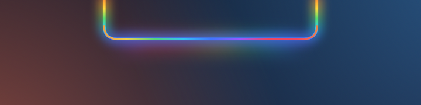
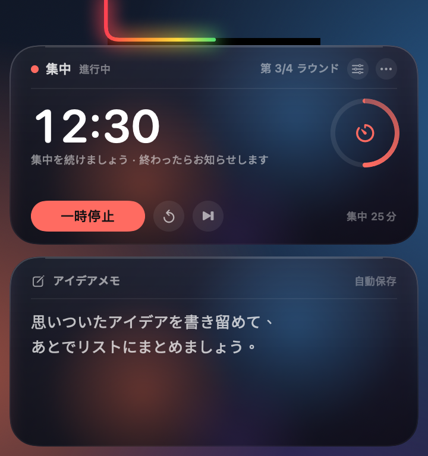
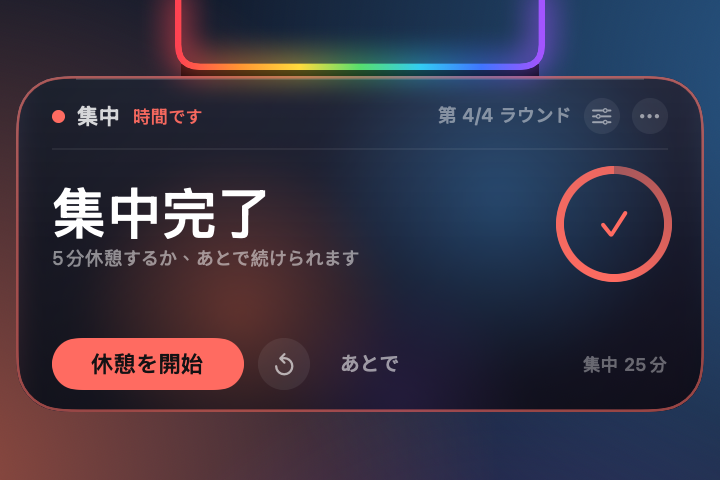
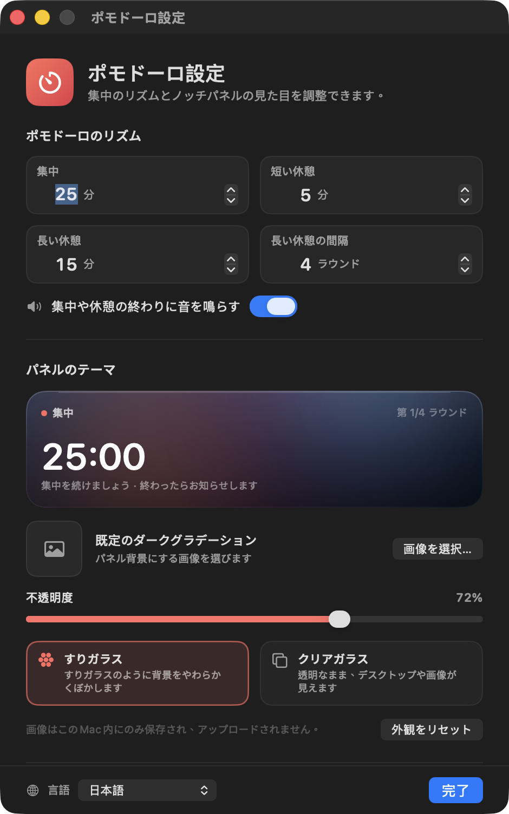

# ノッチのポモドーロ + アイデアメモ

[English](README.md) · [简体中文](README.zh-CN.md) · [繁體中文](README.zh-TW.md) · **日本語** · [한국어](README.ko.md) · [Español](README.es.md) · [Français](README.fr.md) · [Deutsch](README.de.md)

MacBook のノッチに常駐する、ポモドーロタイマーとクイックメモのボードです。セッションを実行している間は、ノッチを囲むレインボーがカウントダウンの進捗バーに変わります。

> **ノッチ付きの MacBook 専用です。** ノッチのない Mac と外部ディスプレイはサポート対象外です。


[](LICENSE)

待機中は、レインボーがノッチの左・下・右の縁を流れています。集中セッションや休憩を始めると、レインボーは進捗バーに変わり、U 字型の縁を左から右へ塗りつぶしていきます。ノッチにポインタを合わせると展開し、上にタイマー、下にメモボードが現れます。セッションが終わるとタイマーカードだけが表示され、メモは邪魔にならないよう隠れたままです。

## 対応環境

このアプリは**ノッチ付き MacBook** 専用に作られており、汎用的なメニューバータイマーではありません：

- 14／16 インチの MacBook Pro（M1 Pro 以降）と 13／15 インチの MacBook Air（M2 以降）
- 14 インチ M4 搭載 MacBook（論理解像度 1470×956、ノッチ幅 179pt）でテスト済み
- macOS 14 以降
- ノッチのない Mac と外部ディスプレイは対象環境ではありません。フォールバックの描画はありますが、レイアウトとサイズは保証されません
- バイナリは Universal（Apple Silicon + Intel）ですが、想定しているハードウェアは Apple Silicon のノッチ付き MacBook です

**待機中 — レインボーがノッチの周りを流れます**



**展開時 — 上にタイマー、下にアイデアメモ**



**セッション終了 — タイマーだけのリマインダー**



> スクリーンショットはサンプルデータです。集中 `12:30`（進捗は約半分）、今日の第 3 ラウンド、メモはサンプル文になっています。待機中の画像はセッション開始前の流れるレインボー、展開時の画像はレインボーが半分まで塗られており、現在の集中の進捗と一致しています。

## レインボーが進捗バーになります

- **カウントダウンしていないとき（準備完了／待機中）**：元のレインボーが 3 辺すべてを流れ続けます
- **集中・短い休憩・長い休憩の実行中**：レインボーが進捗バーになり、U 字型のノッチの縁を左から右へ塗りつぶします
- **0%**：レインボーはまったく描かれません。**100%**：U 字型の縁がすべて点灯します
- **一時停止中**：進捗バーが現在の位置で止まります
- **完了**：100% のまま、リマインダー中はゆっくり脈動します
- **リセット／スキップ**：準備完了に戻り、流れるレインボーが復活します
- 進捗は実際の終了時刻から計算されるため、1 秒ごとに飛ぶのではなく滑らかに動きます。収納時も展開時も確認できます

## ポモドーロ

- 既定は **集中 25 分／短い休憩 5 分／長い休憩 15 分** です
- **集中 4 ラウンド**ごとに長い休憩が入ります。3 つの時間と間隔はすべて設定できます
- 大きな数字が現在のカウントダウン、右側のリングがこのラウンドの進捗を示します
- **集中を開始／一時停止／再開／このラウンドをリセット／このラウンドをスキップ**
- ヘッダーには現在のフェーズと今日完了したラウンド数が表示されます。休憩フェーズでは緑または青に変わります
- 集中や休憩が終わるとシステム音が鳴ります（オフにできます）
- **⟳** はこのラウンドをリセット、**⏭** はスキップします。集中をスキップしても今日のラウンド数には数えられません

### 終了時のリマインダー

- パネルは自動的に展開しますが、**表示されるのはタイマーカードだけ**です。メモカードは一時的に隠れます
- カードには色付きの枠が付き、ノッチのレインボーが脈動します
- 集中が終わると「集中完了」と表示され、その場で休憩を始めるか、**あとで** を選べます
- 休憩が終わると「休憩終了」と表示され、その場で次の集中を始められます
- 操作がないまま約 20 秒たつとリマインダーは収納されます。カードにポインタを合わせている間は開いたままです
- **あとで** はリマインダーを閉じるだけで、完了状態は保持されます。あとでノッチにポインタを合わせればカードが再び表示されます
- 時間切れのときにメモを入力中だった場合は入力を終了してリマインダーを優先するので、見逃すことはありません

## アイデアメモ

- テキストエリアをクリックして入力します。複数行、スクロール、取り消し／やり直し、コピー＆ペーストに対応しています
- 入力が止まってから約 0.4 秒後に保存され、右上に「自動保存」と表示されます
- 入力中はパネルが展開したままになります。ほかのアプリやデスクトップをクリックすると収納されます
- **⋯ → メモを消去…**（確認あり）または設定ウインドウから消去できます
- メモは使用時間データとは別に保存されるため、使用時間の統計をリセットしても削除されません

## パネルのテーマ

設定はタイマーカードの**歯車**、または **⋯ → 外観とタイマー設定…** から開けます。



- **カスタム画像**：PNG／JPEG／HEIC の画像を選べます。画像はアプリのデータフォルダにコピーされ、長辺 2400 px にリサイズされるため、元のファイルは変更されません
- **不透明度**：8%〜100% で、画像やガラスがどれだけ透けるかを調整します。初めて画像を選ぶと 80% に上がります
- **すりガラス**：内蔵のやわらかなガラス層です。カスタム画像は、すりガラス越しに見たようにぼかされます
- **クリアガラス**：より透明で、画像はくっきりしたまま表示されます。画像を設定していないときはデスクトップが見えます
- どちらのスタイルも暗い保護層を重ねるため、明るい背景でも白い文字が読みやすく保たれます
- **画像を削除**／**外観をリセット** でいつでも既定の状態に戻せます
- 画像はこの Mac 内にのみ保存され、アップロードされることはなく、画面収録の権限も必要ありません

> すりガラスモードは内蔵のやわらかな層（と、ぼかしたカスタム画像）を使い、デスクトップをキャプチャしません。クリアガラスモードはデスクトップや画像をそのまま表示します。「自分のデスクトップを、やわらかくぼかして」使いたい場合は、デスクトップのスクリーンショットや壁紙をテーマ画像に設定してください。

## 言語

インターフェースは **8 言語** に対応しています：

- English（英語）
- 简体中文（簡体字中国語）
- 繁體中文（繁体字中国語）
- 日本語
- 한국어（韓国語）
- Español（スペイン語）
- Français（フランス語）
- Deutsch（ドイツ語）

**システム** を選ぶと macOS の言語に従います。手動で選ぶ場合は、設定ウインドウの左下にある地球儀メニューから言語を選べます。変更はパネル、リマインダー、コンテキストメニュー、設定ウインドウにすぐ反映され、再起動は不要です。Finder に表示される名前もシステム言語に従います。

## 使い方

- **展開**：ポインタをノッチ、またはその下のレインボーの帯に移動します。約 0.12 秒で開きます
- **開いたままにする**：カードの中にポインタを移すと開いたままになります。ただホバーするだけでは、現在のアプリからキーボードフォーカスを奪いません
- **タイマーのボタン**：最初のクリックで反応し、アプリを前面に出すことも作業を中断させることもありません
- **メモを書く**：メモ領域をクリックすると入力できるようになります。終わったらほかのアプリかデスクトップをクリックしてください
- **収納**：ポインタがカードから離れて約 0.3 秒後です。メモを入力している間は開いたままです
- **その他のメニュー**：カードの **⋯** をクリックするか、タイマーカードを右クリックします
  - 開始／一時停止／再開
  - このラウンドをリセット、このラウンドをスキップ
  - 外観とタイマー設定
  - ログイン時に起動
  - メモを消去
  - データフォルダを開く
  - 使用時間の統計をリセット
  - 終了
- **一時的な表示**：Finder でもう一度アプリをダブルクリックすると、カードが約 4 秒間開きます
- フルスクリーンのアプリや別のスペースでも動作します。カードは画面の最前面に表示され、Dock の領域を取りません

## タイマーとリマインダーの仕様

- ポモドーロは 1 秒ずつ加算するのではなく終了時刻を基準にしているため、処理が止まったり短時間スリープしたりしても大きくずれません
- 集中を完了すると「今日」と長い休憩のサイクルに加算されます。短い休憩を完了してもラウンドは増えません
- 長い休憩のあとは、ラウンドカウンターが 1 から始まります
- 集中をスキップしてもラウンドは増えません。長い休憩をスキップまたは完了するとサイクルがリセットされます
- 今日の集中ラウンドは現地時間の深夜 0 時に切り替わります
- カウントダウンは画面ロック、スリープ、アプリの切り替えをまたいで動き続けます。時間になるとノッチにリマインダーが表示されます
- パソコンの使用時間は今もバックグラウンドで記録されています（元々の機能）。上部のカードには表示されなくなりました。「今日／累計の使用時間」はステータスバーまたはカードのメニューで確認できます

## データとプライバシー

- 使用時間データ：`~/Library/Application Support/UsageClock/usage.json`
- メモ：`~/Library/Application Support/UsageClock/memo.txt`（入力から約 0.4 秒後に自動保存）
- テーマ画像：`~/Library/Application Support/UsageClock/theme-image.png`（任意）
- ポモドーロとテーマの設定：システムの `UserDefaults`（`com.dumaster.usageclock`）
- 使用時間は約 20 秒ごと、ロック／スリープ時、終了時に保存されます
- アプリごとの追跡は行わず、ほかの情報も収集せず、ネットワーク通信も行いません
- 使用時間のリセット／メモの消去／テーマ画像の削除は元に戻せません

## ダウンロード

最新の `UsageClock.zip` を [GitHub Releases](https://github.com/liutongqi0-star/notch-pomodoro/releases/latest) からダウンロードして解凍し、`UsageClock.app` を Applications フォルダにドラッグしてください。初回起動時に「開発元を確認できない」と表示された場合は、アプリを右クリック → **開く** を選びます。

ソースからビルドすることもできます（下記参照）。

## インストール

```bash
git clone https://github.com/liutongqi0-star/notch-pomodoro.git
cd notch-pomodoro
./install.sh
```

インストールスクリプトの動作：

- `UsageClock.app` を `~/Applications/` にコピーします（現在のユーザーのみ、管理者パスワードは不要）
- ログイン時に起動するためのログイン項目を `~/Library/LaunchAgents/com.dumaster.usageclock.plist` に書き込みます
- アプリをすぐに起動します

起動するとレインボーがノッチの周りを流れます。ポインタを合わせるとタイマーとメモが表示されます。

## アンインストール

```bash
./uninstall.sh          # asks whether to delete recorded data
./uninstall.sh --purge  # also deletes recorded data
```

手動で削除する場合：

```bash
rm -rf ~/Applications/UsageClock.app
rm -f ~/Library/LaunchAgents/com.dumaster.usageclock.plist
rm -rf "$HOME/Library/Application Support/UsageClock"   # optional: usage, notes, theme image
```

## ソースからビルド

必要なもの：macOS 14 以降、Xcode／Command Line Tools。

```bash
cd notch-pomodoro
./build.sh
```

スクリプトは `swiftc` で Universal バイナリ（Apple Silicon + Intel）をコンパイルし、トマトのアイコンを生成して ad-hoc 署名を付けたうえで、次のファイルを出力します：

- `UsageClock.app`
- `build/UsageClock.zip`

ウインドウを表示せずにパネルの各要素をレンダリングするには（素材作成やデバッグ用）：

```bash
mkdir -p /tmp/usageclock-preview
USAGECLOCK_RENDER_PREVIEW=1 \
USAGECLOCK_LANGUAGE=en \
USAGECLOCK_DATA_DIR=/tmp/usageclock-preview \
USAGECLOCK_AGENT_DIR=/tmp/usageclock-preview \
USAGECLOCK_PREVIEW_DIR=/tmp/usageclock-preview \
./UsageClock.app/Contents/MacOS/UsageClock
```

次のファイルが出力されます：

- `preview-cap.png`：3 辺のレインボー
- `preview-body.png`：展開したタイマーとメモ
- `preview-reminder.png`：タイマーだけのリマインダー

UI の翻訳は `Localization/*.json` にあります。編集したあとは `python3 Tools/generate_localization.py` を実行して `Sources/L10nCatalog.swift` を再生成してください。

## プロジェクト構成

```
UsageClock/
├── Sources/
│   ├── main.swift                  # entry point (+ offline preview rendering)
│   ├── AppDelegate.swift           # lifecycle, settings window, completion notifications
│   ├── AppModel.swift              # usage tracking, state detection, persistence
│   ├── PomodoroEngine.swift        # timer state machine, durations, long-break cycle
│   ├── PomodoroCard.swift          # top timer card
│   ├── Localization.swift          # language selection, lookup, runtime switching
│   ├── L10nCatalog.swift           # generated translation tables
│   ├── ThemeModel.swift            # theme image, opacity, glass style
│   ├── ThemeView.swift             # card background, glass layers, settings preview
│   ├── SettingsView.swift          # settings window content
│   ├── SettingsWindowController.swift
│   ├── UsageStore.swift            # usage JSON
│   ├── LoginItem.swift             # login item (LaunchAgent)
│   ├── TimeFormat.swift            # duration/countdown formatting
│   ├── MemoStore.swift             # memo persistence
│   ├── MemoEditor.swift            # native multiline editor
│   ├── NotchGeometry.swift         # notch position / panel sizes / hit areas
│   ├── NotchView.swift             # rainbow, expanded card, animation
│   ├── NotchInteractionView.swift  # hover / button clicks / context menu
│   ├── NotchController.swift       # panels, expand/collapse, reminder state, menu
│   └── StatusBarController.swift   # menu bar (secondary entry point)
├── Localization/                   # en, zh-Hans, zh-Hant, ja, ko, es, fr, de
├── Resources/                      # localized InfoPlist.strings
├── Tools/
│   ├── MakeIcon.swift              # app icon generator
│   ├── WindowID.swift              # debug helper: list window IDs
│   └── generate_localization.py    # validates JSON and generates L10nCatalog.swift
├── docs/                           # screenshots (docs/en for English)
├── Info.plist
├── build.sh
├── install.sh
└── uninstall.sh
```

## よくある質問

**ノッチにレインボーが出ない**
アプリが起動しているか確認してください（`pgrep -x UsageClock`）。この Mac にノッチがない場合や、主に外部ディスプレイを使っている場合は、現在のメインディスプレイの上部中央に黒いノッチ形状とレインボーを描画します。その場合でもポインタを合わせれば展開します。

**レインボーの一部しか光らないのはなぜ？**
それは現在のカウントダウンの進捗です。0% では何も表示されず、100% で U 字型の縁がすべて点灯します。集中や休憩が終わると 100% になります。全体が流れるレインボーは待機状態のものです。

**リマインダーがすぐ消えてしまう**
操作がないまま約 20 秒たつと収納されます。カードにポインタを合わせている間は開いたままです。**あとで** でも閉じられますが、完了状態は残るので、もう一度ノッチにポインタを合わせればカードが表示され、次のフェーズを始められます。

**すりガラスなのにデスクトップがぼやけないのはなぜ？**
すりガラスモードは内蔵のやわらかな層と、ぼかしたカスタム画像を使います。デスクトップを読み取らないため、画面収録の権限は不要です。クリアガラスモードはデスクトップをそのまま表示します。「自分のデスクトップを、やわらかくぼかして」使いたい場合は、デスクトップのスクリーンショットや壁紙をテーマ画像として設定してください。

**クリアガラスだと文字が読みにくい**
クリアガラスモードは透明度が高いため、**不透明度** を上げるか、すりガラスに切り替えるか、画像テーマを使ってください。設定ウインドウにはライブプレビューがあります。

**メモパネルは自動で収納されますか？**
いいえ。メモをクリックして入力を始めると、ほかのアプリかデスクトップをクリックするまでパネルは開いたままです。見るためだけにポインタを合わせた場合は、ポインタが離れて約 0.3 秒後に収納されます。

**メモやテーマ画像はどこに保存されますか？**
`~/Library/Application Support/UsageClock/` の下の `memo.txt` と `theme-image.png` です。メモは ⋯ → メモを消去 で消去でき、テーマ画像は設定で削除できます。

**以前の累計使用時間はどこへ？**
上部のカードはポモドーロタイマーになりました。パソコンの使用時間は今もバックグラウンドで記録されています。⋯ メニューまたはステータスバーのメニューを開くと「今日／累計の使用時間」を確認でき、使用時間の統計をリセットすることもできます。

**メニューバーのアイコンが見えない**
ノッチ付きの Mac では、メニューバーがいっぱいになると macOS がステータス項目をノッチの下に隠すことがあります。アプリの動作には影響しません。ノッチのレインボーとホバーパネルが主な UI です。使っていないメニューバー項目をいくつか外すと戻ります。

**ログイン時に起動が機能しない**
`~/Library/LaunchAgents/com.dumaster.usageclock.plist` が存在するか確認してください。アプリを手動で移動した場合は、一度起動するとパスが更新されます。⋯ メニューで「ログイン時に起動」をオフにしてから、もう一度オンにすることもできます。

**初回起動時に「開発元を確認できない」と表示される**
アプリはローカルで ad-hoc 署名されています。Finder で `UsageClock.app` を右クリック → **開く** を選ぶか、次を実行してください：

```bash
xattr -dr com.apple.quarantine ~/Applications/UsageClock.app
```

---

現在のバージョン：**3.2.0（build 12）**

リポジトリ：<https://github.com/liutongqi0-star/notch-pomodoro>

## ライセンス

MIT License. 詳細は [LICENSE](LICENSE) を参照してください。
