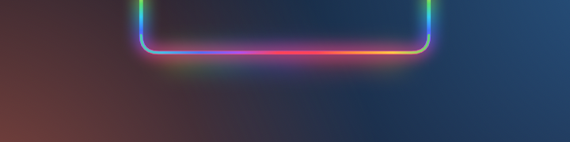
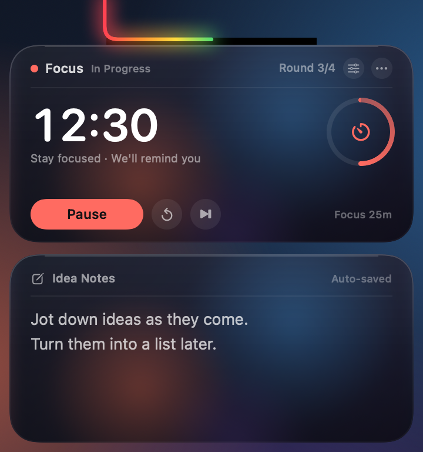
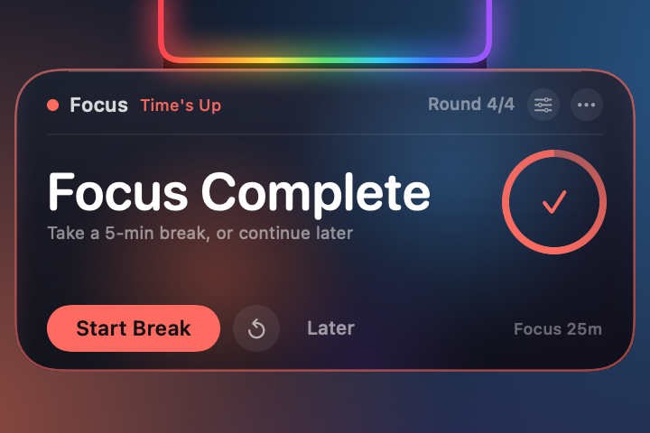
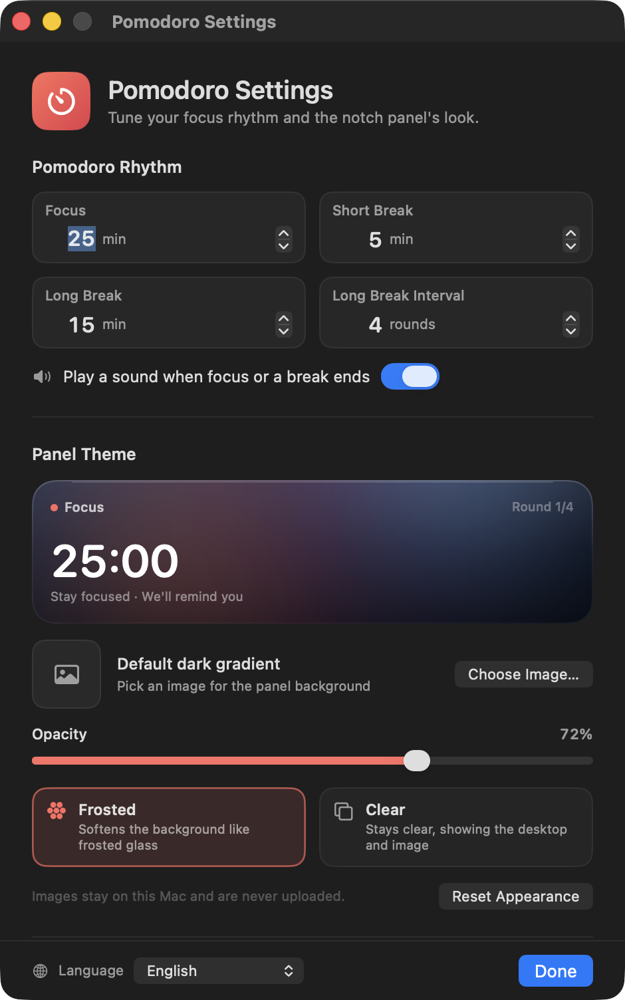

# 노치 포모도로 + 아이디어 메모

[English](README.md) · [简体中文](README.zh-CN.md) · [繁體中文](README.zh-TW.md) · [日本語](README.ja.md) · **한국어** · [Español](README.es.md) · [Français](README.fr.md) · [Deutsch](README.de.md)

MacBook 노치에 붙어 사는 포모도로 타이머와 빠른 메모 보드입니다. 세션이 진행되는 동안 노치를 둘러싼 무지개가 카운트다운 진행률 표시줄로 바뀝니다.

> **노치가 있는 MacBook 전용입니다.** 노치가 없는 Mac과 외장 디스플레이는 지원 대상이 아닙니다.


[](LICENSE)

평소에는 무지개가 노치의 왼쪽, 아래, 오른쪽 가장자리를 따라 흐릅니다. 집중 세션이나 휴식을 시작하면 무지개가 진행률 표시줄로 바뀌어 U자형 테두리를 왼쪽에서 오른쪽으로 채웁니다. 노치에 포인터를 올리면 펼쳐집니다. 위에는 타이머, 아래에는 메모 보드가 있습니다. 세션이 끝나면 타이머 카드만 나타나고 메모는 비켜 있습니다.

## 호환성

이 앱은 일반적인 메뉴 막대 타이머가 아니라 **노치가 있는 MacBook**을 위해 만들어졌습니다:

- 14/16인치 MacBook Pro(M1 Pro 이후)와 13/15인치 MacBook Air(M2 이후)
- 14인치 M4 MacBook, 논리 해상도 1470×956, 노치 너비 179 pt에서 테스트
- macOS 14 이상
- 노치가 없는 Mac과 외장 디스플레이는 대상 환경이 아닙니다. 대체 그리기가 있지만 레이아웃과 크기는 보장되지 않습니다
- 바이너리는 Universal(Apple Silicon + Intel)이지만 의도된 하드웨어는 Apple Silicon 노치 MacBook입니다

**유휴 — 무지개가 노치를 따라 흐릅니다**



**펼침 — 위에는 타이머, 아래에는 아이디어 메모**



**세션 종료 — 타이머만 보이는 알림**



> 스크린샷은 예시 데이터를 사용합니다: 집중 `12:30`(진행률 약 절반), 오늘 3라운드, 예시 메모 텍스트. 유휴 이미지는 세션 시작 전 흐르는 무지개를 보여 주고, 펼침 이미지에서는 무지개가 절반까지 채워져 현재 집중 진행률과 일치합니다.

## 무지개가 곧 진행률 표시줄

- **활성 카운트다운 없음(준비됨/유휴)**: 원래의 무지개가 세 면을 따라 계속 흐릅니다
- **집중, 짧은 휴식, 긴 휴식 진행 중**: 무지개가 진행률 표시줄로 바뀌어 U자형 노치 테두리를 왼쪽에서 오른쪽으로 채웁니다
- **0%**: 무지개가 전혀 없음, **100%**: U자형 테두리 전체가 켜짐
- **일시정지**: 진행률 표시줄이 현재 위치에서 멈춥니다
- **완료**: 100%를 유지하며 알림 동안 부드럽게 맥동합니다
- **초기화 / 건너뛰기**: 준비 상태로 돌아가고 흐르는 무지개가 다시 나타납니다
- 진행률은 실제 종료 시각을 기준으로 계산되므로 1초에 한 번씩 튀지 않고 부드럽게 움직이며, 접힌 상태와 펼친 상태 모두에서 보입니다

## 포모도로

- 기본값은 **집중 25분 / 짧은 휴식 5분 / 긴 휴식 15분**입니다
- **집중 4라운드**마다 긴 휴식이 이어지며, 세 가지 길이와 간격은 모두 설정할 수 있습니다
- 큰 숫자는 현재 카운트다운이고, 오른쪽 링은 이번 라운드의 진행률을 보여 줍니다
- **집중 시작 / 일시정지 / 계속 / 이번 라운드 초기화 / 이번 라운드 건너뛰기**
- 헤더에는 현재 단계와 오늘 완료한 라운드 수가 표시되며, 휴식 단계에서는 초록색이나 파란색으로 바뀝니다
- 집중이나 휴식이 끝나면 시스템 사운드가 재생됩니다(끌 수 있음)
- **⟳**는 이번 라운드를 초기화하고 **⏭**는 건너뜁니다. 집중을 건너뛰면 오늘 라운드에 포함되지 않습니다

### 세션 종료 알림

- 패널이 자동으로 펼쳐지지만 **타이머 카드만 표시**되고 메모 카드는 잠시 숨겨집니다
- 카드에 색상 테두리가 생기고 노치의 무지개가 맥동합니다
- 집중이 끝나면 "집중 완료"가 표시됩니다. 곧바로 휴식을 시작하거나 **나중에**를 선택하세요
- 휴식이 끝나면 "휴식 종료"가 표시됩니다. 곧바로 다음 집중을 시작하세요
- 아무 동작이 없으면 약 20초 후 알림이 접힙니다. 카드 위에 포인터를 두면 열린 상태로 유지됩니다
- **나중에**는 알림만 닫습니다. 완료 상태는 유지되므로 나중에 노치에 포인터를 올리면 카드가 다시 나타납니다
- 메모를 입력하는 중에 시간이 되면 입력이 끝나고 알림이 우선 표시되어 놓치지 않습니다

## 아이디어 메모

- 텍스트 영역을 클릭하고 입력하세요. 여러 줄, 스크롤, 실행 취소/재실행, 복사/붙여넣기를 지원합니다
- 입력을 멈추고 약 0.4초 후 저장되며, 오른쪽 위에 "자동 저장됨"이 표시됩니다
- 입력하는 동안 패널은 펼쳐진 상태를 유지하고, 다른 앱이나 데스크톱을 클릭하면 접힙니다
- **⋯ → 메모 지우기…**(확인 포함) 또는 설정 창에서 지울 수 있습니다
- 메모는 사용 데이터와 따로 저장되므로 사용 통계를 초기화해도 삭제되지 않습니다

## 패널 테마

타이머 카드의 **톱니바퀴**에서 설정을 열거나 **⋯ → 모양 및 타이머 설정…**을 선택하세요.



- **사용자 이미지**: PNG / JPEG / HEIC 이미지를 선택합니다. 이미지는 앱 데이터 폴더로 복사되고 최대 변이 2400 px로 조정되므로 원본 파일은 그대로 유지됩니다
- **불투명도**: 8%–100%로, 이미지와 유리가 얼마나 비쳐 보이는지 조절합니다. 처음 이미지를 선택하면 80%로 올라갑니다
- **프로스트**: 기본 제공되는 부드러운 유리 레이어로, 사용자 이미지도 프로스트 유리 너머로 보는 것처럼 부드럽게 처리됩니다
- **클리어**: 더 투명하고 이미지는 선명하게 유지되며, 이미지가 없으면 데스크톱이 보입니다
- 두 스타일 모두 어두운 보호 레이어를 더해 밝은 배경에서도 흰색 텍스트를 읽을 수 있습니다
- **이미지 제거** / **모양 초기화**로 언제든 기본값으로 되돌릴 수 있습니다
- 이미지는 이 Mac에만 저장되고 업로드되지 않으며 화면 기록 권한이 필요하지 않습니다

> 프로스트 모드는 기본 제공되는 부드러운 레이어(와 부드럽게 처리된 사용자 이미지)를 사용하며 데스크톱을 캡처하지 않습니다. 클리어 모드는 데스크톱이나 이미지를 그대로 보여 줍니다. "내 데스크톱을 부드럽게 흐리게" 원한다면 데스크톱 스크린샷이나 배경화면을 테마 이미지로 지정하세요.

## 언어

인터페이스는 **8개 언어**로 제공됩니다:

- English
- 简体中文 (중국어 간체)
- 繁體中文 (중국어 번체)
- 日本語 (일본어)
- 한국어
- Español (스페인어)
- Français (프랑스어)
- Deutsch (독일어)

macOS 언어를 따르려면 **시스템**을 선택하고, 설정 창 왼쪽 아래의 지구본 메뉴에서 언어를 직접 고를 수도 있습니다. 변경 사항은 패널, 알림, 컨텍스트 메뉴, 설정 창에 즉시 적용되며 재시작이 필요 없습니다. Finder에 표시되는 이름도 시스템 언어를 따릅니다.

## 사용 방법

- **펼치기**: 포인터를 노치나 그 아래 무지개 띠로 옮기면 약 0.12초 후 열립니다
- **열어 두기**: 카드 안으로 들어가면 열린 상태가 유지되고, 포인터를 올려 두기만 해서는 현재 앱의 키보드 포커스를 빼앗지 않습니다
- **타이머 버튼**: 앱을 활성화하거나 작업을 방해하지 않고 첫 클릭에 반응합니다
- **메모 쓰기**: 메모 영역을 클릭하면 입력이 활성화됩니다. 끝나면 다른 앱이나 데스크톱을 클릭하세요
- **접기**: 포인터가 카드를 벗어나고 약 0.3초 후 접힙니다. 메모를 입력하는 동안에는 열린 상태로 유지됩니다
- **더 보기 메뉴**: 카드의 **⋯**를 클릭하거나 타이머 카드를 오른쪽 클릭하세요
  - 시작 / 일시정지 / 계속
  - 이번 라운드 초기화, 이번 라운드 건너뛰기
  - 모양 및 타이머 설정
  - 로그인 시 실행
  - 메모 지우기
  - 데이터 폴더 열기
  - 사용 통계 초기화
  - 종료
- **일시 표시**: Finder에서 앱을 다시 더블 클릭하면 카드가 약 4초 동안 열립니다
- 전체 화면 앱과 여러 Space에서 동작하며, 카드는 화면 맨 위에 머물고 Dock 공간을 차지하지 않습니다

## 타이머 및 알림 규칙

- 포모도로는 1초씩 더하는 방식이 아니라 종료 시각을 사용하므로, 멈춤이나 짧은 잠자기 후에도 눈에 띄게 밀리지 않습니다
- 집중을 완료하면 "오늘"과 긴 휴식 주기에 반영되고, 짧은 휴식을 완료해도 라운드는 늘지 않습니다
- 긴 휴식 후에는 라운드 카운터가 1부터 다시 시작합니다
- 집중을 건너뛰면 라운드가 늘지 않고, 긴 휴식을 건너뛰거나 완료하면 주기가 초기화됩니다
- 오늘의 집중 라운드는 자정(로컬 시간)에 넘어갑니다
- 카운트다운은 화면 잠금, 잠자기, 앱 전환 중에도 계속 진행되며, 시간이 되면 노치에 알림이 나타납니다
- 컴퓨터 사용 시간은 백그라운드에서 계속 기록됩니다(원래 기능). 더 이상 상단 카드에는 표시되지 않으며, 상태 막대나 카드 메뉴에서 "오늘 / 전체 사용"을 확인하세요

## 데이터 및 개인정보

- 사용 데이터: `~/Library/Application Support/UsageClock/usage.json`
- 메모: `~/Library/Application Support/UsageClock/memo.txt` (입력 후 약 0.4초 뒤 자동 저장)
- 테마 이미지: `~/Library/Application Support/UsageClock/theme-image.png` (선택 사항)
- 포모도로 및 테마 설정: 시스템 `UserDefaults` (`com.dumaster.usageclock`)
- 사용 시간은 약 20초마다, 화면 잠금/잠자기 시, 종료 시 저장됩니다
- 앱별 추적은 하지 않으며 다른 정보를 수집하지 않고 네트워크 요청도 보내지 않습니다
- 사용 시간 초기화 / 메모 지우기 / 테마 이미지 제거는 되돌릴 수 없습니다

## 다운로드

[GitHub Releases](https://github.com/liutongqi0-star/notch-pomodoro/releases/latest)에서 최신 `UsageClock.zip`을 내려받아 압축을 풀고 `UsageClock.app`을 응용 프로그램 폴더로 끌어다 놓으세요. 첫 실행 시 macOS에서 개발자를 확인할 수 없다고 하면 앱을 오른쪽 클릭 → **열기**를 선택하세요.

소스에서 직접 빌드할 수도 있습니다(아래 참고).

## 설치

```bash
git clone https://github.com/liutongqi0-star/notch-pomodoro.git
cd notch-pomodoro
./install.sh
```

설치 스크립트는:

- `UsageClock.app`을 `~/Applications/`에 복사합니다(현재 사용자, 관리자 암호 불필요)
- 로그인 시 실행되도록 `~/Library/LaunchAgents/com.dumaster.usageclock.plist`에 로그인 항목을 기록합니다
- 앱을 즉시 실행합니다

실행되면 무지개가 노치를 따라 흐릅니다. 노치에 포인터를 올리면 타이머와 메모가 보입니다.

## 제거

```bash
./uninstall.sh          # asks whether to delete recorded data
./uninstall.sh --purge  # also deletes recorded data
```

직접 제거하려면:

```bash
rm -rf ~/Applications/UsageClock.app
rm -f ~/Library/LaunchAgents/com.dumaster.usageclock.plist
rm -rf "$HOME/Library/Application Support/UsageClock"   # optional: usage, notes, theme image
```

## 소스에서 빌드

요구 사항: macOS 14 이상, Xcode / Command Line Tools.

```bash
cd notch-pomodoro
./build.sh
```

스크립트는 `swiftc`로 Universal 바이너리(Apple Silicon + Intel)를 컴파일하고, 토마토 아이콘을 생성하고, ad-hoc 서명을 적용한 뒤 다음을 만듭니다:

- `UsageClock.app`
- `build/UsageClock.zip`

창을 띄우지 않고 패널 구성 요소를 렌더링하려면(에셋 제작이나 디버깅용):

```bash
mkdir -p /tmp/usageclock-preview
USAGECLOCK_RENDER_PREVIEW=1 \
USAGECLOCK_LANGUAGE=en \
USAGECLOCK_DATA_DIR=/tmp/usageclock-preview \
USAGECLOCK_AGENT_DIR=/tmp/usageclock-preview \
USAGECLOCK_PREVIEW_DIR=/tmp/usageclock-preview \
./UsageClock.app/Contents/MacOS/UsageClock
```

다음 파일이 생성됩니다:

- `preview-cap.png`: 3면 무지개
- `preview-body.png`: 펼친 타이머 + 메모
- `preview-reminder.png`: 타이머만 보이는 알림

UI 번역은 `Localization/*.json`에 있습니다. 수정한 뒤 `python3 Tools/generate_localization.py`를 실행하면 `Sources/L10nCatalog.swift`가 다시 생성됩니다.

## 프로젝트 구조

```
UsageClock/
├── Sources/
│   ├── main.swift                  # entry point (+ offline preview rendering)
│   ├── AppDelegate.swift           # lifecycle, settings window, completion notifications
│   ├── AppModel.swift              # usage tracking, state detection, persistence
│   ├── PomodoroEngine.swift        # timer state machine, durations, long-break cycle
│   ├── PomodoroCard.swift          # top timer card
│   ├── Localization.swift          # language selection, lookup, runtime switching
│   ├── L10nCatalog.swift           # generated translation tables
│   ├── ThemeModel.swift            # theme image, opacity, glass style
│   ├── ThemeView.swift             # card background, glass layers, settings preview
│   ├── SettingsView.swift          # settings window content
│   ├── SettingsWindowController.swift
│   ├── UsageStore.swift            # usage JSON
│   ├── LoginItem.swift             # login item (LaunchAgent)
│   ├── TimeFormat.swift            # duration/countdown formatting
│   ├── MemoStore.swift             # memo persistence
│   ├── MemoEditor.swift            # native multiline editor
│   ├── NotchGeometry.swift         # notch position / panel sizes / hit areas
│   ├── NotchView.swift             # rainbow, expanded card, animation
│   ├── NotchInteractionView.swift  # hover / button clicks / context menu
│   ├── NotchController.swift       # panels, expand/collapse, reminder state, menu
│   └── StatusBarController.swift   # menu bar (secondary entry point)
├── Localization/                   # en, zh-Hans, zh-Hant, ja, ko, es, fr, de
├── Resources/                      # localized InfoPlist.strings
├── Tools/
│   ├── MakeIcon.swift              # app icon generator
│   ├── WindowID.swift              # debug helper: list window IDs
│   └── generate_localization.py    # validates JSON and generates L10nCatalog.swift
├── docs/                           # screenshots (docs/en for English)
├── Info.plist
├── build.sh
├── install.sh
└── uninstall.sh
```

## 자주 묻는 질문

**노치에 무지개가 보이지 않나요?**
앱이 실행 중인지 확인하세요(`pgrep -x UsageClock`). 이 Mac에 노치가 없거나 주로 외장 디스플레이를 쓴다면, 앱이 현재 주 화면 상단 중앙에 검은 노치 모양과 무지개를 그립니다. 포인터를 올리면 여전히 펼쳐집니다.

**무지개가 일부만 켜져 있는 이유는 무엇인가요?**
현재 카운트다운 진행률입니다. 0%에서는 아무것도 표시되지 않고, 100%에서 U자형 테두리 전체가 켜집니다. 집중이나 휴식이 끝나면 100%가 되며, 완전히 흐르는 무지개는 유휴 상태의 것입니다.

**알림이 금방 사라졌습니다.**
아무 동작이 없으면 약 20초 후 접힙니다. 카드 위에 포인터를 두면 열린 상태로 유지됩니다. **나중에**를 눌러도 알림이 닫히지만 완료 상태는 남아 있으므로, 노치에 다시 포인터를 올리면 카드가 보이고 다음 단계를 시작할 수 있습니다.

**프로스트 유리가 데스크톱을 흐리게 하지 않는 이유는 무엇인가요?**
프로스트 모드는 기본 제공되는 부드러운 레이어와 부드럽게 처리된 사용자 이미지를 사용하며 데스크톱을 읽지 않으므로 화면 기록 권한이 필요하지 않습니다. 클리어 모드는 데스크톱을 그대로 보여 줍니다. "내 데스크톱을 부드럽게 흐리게" 원한다면 데스크톱 스크린샷이나 배경화면을 테마 이미지로 지정하세요.

**클리어 유리에서 텍스트가 잘 읽히지 않습니다.**
클리어 모드는 더 투명합니다. **불투명도**를 높이거나 프로스트로 전환하거나 이미지 테마를 사용하세요. 설정 창에 실시간 미리보기가 있습니다.

**메모 패널이 자동으로 접히나요?**
아니요. 메모를 클릭해 입력을 시작하면 다른 앱이나 데스크톱을 클릭할 때까지 패널이 열린 상태로 유지됩니다. 보기만 하려고 잠깐 올렸다면 커서가 벗어나고 약 0.3초 후 접힙니다.

**메모와 테마 이미지는 어디에 저장되나요?**
`~/Library/Application Support/UsageClock/` 아래의 `memo.txt`와 `theme-image.png`입니다. 메모는 ⋯ → 메모 지우기로 지우고, 테마 이미지는 설정에서 제거하세요.

**예전의 전체 사용 시간은 어디로 갔나요?**
상단 카드는 이제 포모도로 타이머이고, 컴퓨터 사용 시간은 백그라운드에서 계속 기록됩니다. ⋯ 메뉴나 상태 막대 메뉴를 열어 "오늘 / 전체 사용"을 확인하거나 사용 통계를 초기화하세요.

**메뉴 막대 아이콘이 보이지 않습니다.**
노치가 있는 Mac에서는 메뉴 막대가 꽉 차면 macOS가 상태 항목을 노치 아래로 숨길 수 있습니다. 앱 동작에는 영향이 없습니다. 노치 무지개와 호버 패널이 기본 UI입니다. 덜 쓰는 메뉴 막대 항목 몇 개를 제거하면 다시 나타납니다.

**로그인 시 실행이 동작하지 않습니다.**
`~/Library/LaunchAgents/com.dumaster.usageclock.plist`가 있는지 확인하세요. 앱을 직접 옮겼다면 한 번 실행해 경로를 갱신하세요. ⋯ 메뉴에서 "로그인 시 실행"을 껐다가 다시 켤 수도 있습니다.

**첫 실행 시 "개발자를 확인할 수 없음"이 표시됩니다.**
앱은 로컬에서 ad-hoc 서명되었습니다. Finder에서 `UsageClock.app`을 오른쪽 클릭 → **열기**를 선택하거나 다음을 실행하세요:

```bash
xattr -dr com.apple.quarantine ~/Applications/UsageClock.app
```

---

현재 버전: **3.2.0 (build 12)**

저장소: <https://github.com/liutongqi0-star/notch-pomodoro>

## 라이선스

MIT 라이선스. [LICENSE](LICENSE)를 참고하세요.
