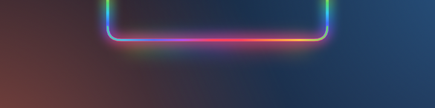
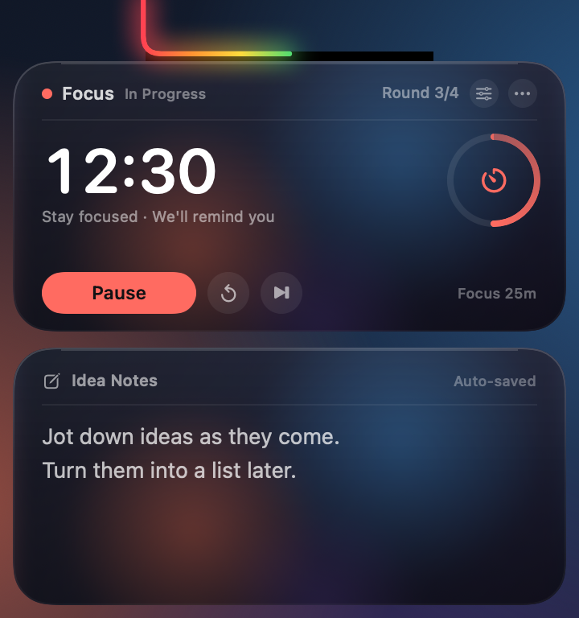
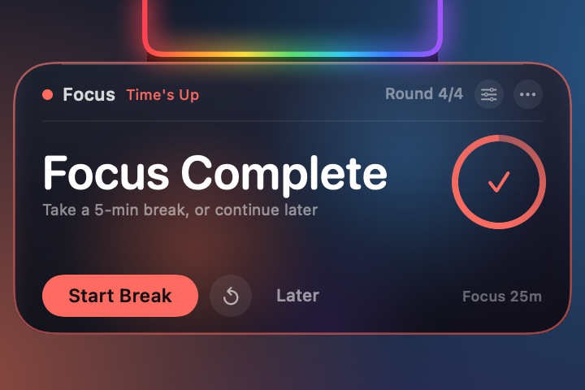
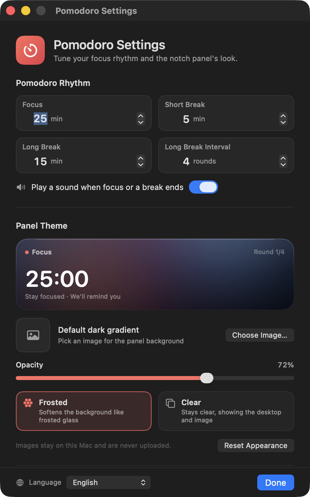

# Notch Pomodoro + Idea Notes

**English** · [简体中文](README.zh-CN.md) · [繁體中文](README.zh-TW.md) · [日本語](README.ja.md) · [한국어](README.ko.md) · [Español](README.es.md) · [Français](README.fr.md) · [Deutsch](README.de.md)

A Pomodoro timer and quick-notes board that lives on the MacBook notch. The rainbow around the notch turns into a countdown progress bar while a session is running.

> **For notched MacBooks only.** Macs without a notch and external displays are not supported targets.


[](LICENSE)

When idle, a rainbow flows around the left, bottom, and right edges of the notch. Start a focus session or a break and the rainbow becomes a progress bar, filling the U-shaped rim from left to right. Hover the notch to expand it: the timer sits above, a memo board below. When a session ends, only the timer card appears — the notes stay out of the way.

## Compatibility

This app is built specifically for **notched MacBooks**, not as a generic menu-bar timer:

- 14/16-inch MacBook Pro (M1 Pro and later) and 13/15-inch MacBook Air (M2 and later)
- Tested on a 14-inch MacBook with M4, 1470×956 logical resolution, 179 pt notch width
- macOS 14 or later
- Macs without a notch and external displays are not target environments; there is fallback drawing, but layout and sizing are not guaranteed
- The binary is Universal (Apple Silicon + Intel), but the intended hardware is Apple Silicon notched MacBooks

**Idle — the rainbow flows around the notch**



**Expanded — timer above, idea notes below**



**Session finished — a timer-only reminder**



> Screenshots use sample data: focus `12:30` (about half progress), round 3 today, and sample note text. The idle image shows the flowing rainbow before a session starts; in the expanded image the rainbow is filled halfway, matching the current focus progress.

## The rainbow is the progress bar

- **No active countdown (ready/idle)**: the original rainbow keeps flowing around all three edges
- **Focus, short break, or long break running**: the rainbow becomes a progress bar, filling the U-shaped notch rim from left to right
- **0%**: no rainbow at all; **100%**: the whole U-shaped rim is lit
- **Paused**: the progress bar freezes at its current position
- **Completed**: stays at 100% and pulses gently during the reminder
- **Reset / skip**: returns to ready, and the flowing rainbow comes back
- Progress is computed from the real end time, so it moves smoothly instead of jumping once per second; it is visible both collapsed and expanded

## Pomodoro

- Defaults to **25 min focus / 5 min short break / 15 min long break**
- A long break every **4 focus rounds**; all three durations and the interval are configurable
- The large number is the current countdown; the ring on the right shows the round's progress
- **Start focus / pause / resume / reset this round / skip this round**
- The header shows the current phase and how many rounds you have completed today; break phases switch to green or blue
- A system sound plays when focus or a break ends (can be disabled)
- **⟳** resets the round; **⏭** skips it. Skipping focus does not count toward today's rounds

### End-of-session reminder

- The panel expands automatically, but **only the timer card is shown**; the memo card is temporarily hidden
- The card gets a colored border and the notch rainbow pulses
- Focus finished shows "Focus Complete": start the break right away, or choose **Later**
- Break finished shows "Break Over": start the next focus right away
- With no interaction the reminder collapses after about 20 seconds; hovering the card keeps it open
- **Later** only dismisses the reminder — the completed state is kept, so hovering the notch later shows the card again
- If you are typing a note when time is up, input ends and the reminder takes over so it is not missed

## Idea notes

- Click the text area and type; supports multiple lines, scrolling, undo/redo, and copy/paste
- Saves about 0.4 seconds after you stop typing, with "Auto-saved" in the top-right corner
- The panel stays expanded while you type; it collapses after you click another app or the desktop
- Clear it from **⋯ → Clear Notes…** (with confirmation) or from the settings window
- Notes are stored separately from usage data, so resetting usage statistics never deletes them

## Panel themes

Open settings from the **gear** on the timer card, or **⋯ → Appearance & Timer Settings…**.



- **Custom image**: choose a PNG / JPEG / HEIC image. It is copied into the app data folder and resized to a 2400 px max edge, so the original file is not touched
- **Opacity**: 8%–100%, controlling how much image/glass shows through; choosing an image for the first time raises it to 80%
- **Frosted**: a built-in soft glass layer; custom images are softened as if seen through frosted glass
- **Clear**: more transparent, keeps images crisp, and shows the desktop when no image is set
- Both styles add a dark protective layer so white text stays readable on bright backgrounds
- **Remove image** / **Reset Appearance** restore the defaults at any time
- Images stay on this Mac, are never uploaded, and require no screen-recording permission

> Frosted mode uses a built-in soft layer (plus a softened custom image) and does not capture the desktop. Clear mode shows the desktop or image directly. If you want "my own desktop, softly blurred", set a desktop screenshot or wallpaper as the theme image.

## Languages

The interface is available in **8 languages**:

- English
- 简体中文 (Simplified Chinese)
- 繁體中文 (Traditional Chinese)
- 日本語 (Japanese)
- 한국어 (Korean)
- Español (Spanish)
- Français (French)
- Deutsch (German)

Choose **System** to follow the macOS language, or pick a language manually from the globe menu at the bottom-left of the settings window. Changes apply immediately to the panel, reminder, context menus, and settings window — no restart required. The name shown in Finder also follows the system language.

## Using it

- **Expand**: move the pointer to the notch, or to the rainbow strip below it; it opens after about 0.12 seconds
- **Keep open**: moving into the card keeps it open; hovering alone does not steal keyboard focus from the current app
- **Timer buttons**: respond on the first click without activating the app or interrupting your work
- **Write a note**: clicking the memo area activates input; click another app or the desktop when finished
- **Collapse**: about 0.3 seconds after the pointer leaves the card; it stays open while you are typing a note
- **More menu**: click **⋯** on the card, or right-click the timer card
  - Start / pause / resume
  - Reset this round, skip this round
  - Appearance & timer settings
  - Launch at login
  - Clear notes
  - Open data folder
  - Reset usage statistics
  - Quit
- **Temporary reveal**: double-click the app again in Finder and the card opens for about 4 seconds
- Works on full-screen apps and different spaces; the card stays at the top of the screen and takes no Dock space

## Timer and reminder rules

- The Pomodoro uses an end time instead of adding one second at a time, so it does not drift noticeably after a stall or a short sleep
- Finishing focus counts toward "today" and the long-break cycle; finishing a short break does not add a round
- After a long break the round counter starts again at 1
- Skipping focus does not add a round; skipping or completing a long break resets the cycle
- Today's focus rounds roll over at local midnight
- The countdown keeps running through lock screen, sleep, and app switching; the reminder appears on the notch when time is up
- Computer usage time is still recorded in the background (the original feature). It is no longer shown in the top card; see "today / total usage" in the status-bar or card menu

## Data and privacy

- Usage data: `~/Library/Application Support/UsageClock/usage.json`
- Notes: `~/Library/Application Support/UsageClock/memo.txt` (autosaved about 0.4 s after typing)
- Theme image: `~/Library/Application Support/UsageClock/theme-image.png` (optional)
- Pomodoro and theme settings: system `UserDefaults` (`com.dumaster.usageclock`)
- Usage is saved about every 20 seconds, on lock/sleep, and on quit
- No per-app tracking, no other information collected, and no network requests
- Resetting usage / clearing notes / removing the theme image cannot be undone

## Download

Download the latest `UsageClock.zip` from [GitHub Releases](https://github.com/liutongqi0-star/notch-pomodoro/releases/latest), unzip it, and drag `UsageClock.app` into Applications. If macOS says the developer cannot be verified on first launch, right-click the app → **Open**.

You can also build from source (see below).

## Install

```bash
git clone https://github.com/liutongqi0-star/notch-pomodoro.git
cd notch-pomodoro
./install.sh
```

The install script:

- copies `UsageClock.app` to `~/Applications/` (current user, no admin password)
- writes a login item at `~/Library/LaunchAgents/com.dumaster.usageclock.plist` for launch at login
- starts the app immediately

Once running, the rainbow flows around the notch; hover it to see the timer and notes.

## Uninstall

```bash
./uninstall.sh          # asks whether to delete recorded data
./uninstall.sh --purge  # also deletes recorded data
```

Or remove it manually:

```bash
rm -rf ~/Applications/UsageClock.app
rm -f ~/Library/LaunchAgents/com.dumaster.usageclock.plist
rm -rf "$HOME/Library/Application Support/UsageClock"   # optional: usage, notes, theme image
```

## Build from source

Requirements: macOS 14 or later, Xcode / Command Line Tools.

```bash
cd notch-pomodoro
./build.sh
```

The script compiles a Universal binary (Apple Silicon + Intel) with `swiftc`, generates the tomato icon, applies an ad-hoc signature, and produces:

- `UsageClock.app`
- `build/UsageClock.zip`

To render the panel components without showing windows (for assets or debugging):

```bash
mkdir -p /tmp/usageclock-preview
USAGECLOCK_RENDER_PREVIEW=1 \
USAGECLOCK_LANGUAGE=en \
USAGECLOCK_DATA_DIR=/tmp/usageclock-preview \
USAGECLOCK_AGENT_DIR=/tmp/usageclock-preview \
USAGECLOCK_PREVIEW_DIR=/tmp/usageclock-preview \
./UsageClock.app/Contents/MacOS/UsageClock
```

This produces:

- `preview-cap.png`: the three-sided rainbow
- `preview-body.png`: the expanded timer + notes
- `preview-reminder.png`: the timer-only reminder

UI translations live in `Localization/*.json`; after editing them, run `python3 Tools/generate_localization.py` to regenerate `Sources/L10nCatalog.swift`.

## Project structure

```
UsageClock/
├── Sources/
│   ├── main.swift                  # entry point (+ offline preview rendering)
│   ├── AppDelegate.swift           # lifecycle, settings window, completion notifications
│   ├── AppModel.swift              # usage tracking, state detection, persistence
│   ├── PomodoroEngine.swift        # timer state machine, durations, long-break cycle
│   ├── PomodoroCard.swift          # top timer card
│   ├── Localization.swift          # language selection, lookup, runtime switching
│   ├── L10nCatalog.swift           # generated translation tables
│   ├── ThemeModel.swift            # theme image, opacity, glass style
│   ├── ThemeView.swift             # card background, glass layers, settings preview
│   ├── SettingsView.swift          # settings window content
│   ├── SettingsWindowController.swift
│   ├── UsageStore.swift            # usage JSON
│   ├── LoginItem.swift             # login item (LaunchAgent)
│   ├── TimeFormat.swift            # duration/countdown formatting
│   ├── MemoStore.swift             # memo persistence
│   ├── MemoEditor.swift            # native multiline editor
│   ├── NotchGeometry.swift         # notch position / panel sizes / hit areas
│   ├── NotchView.swift             # rainbow, expanded card, animation
│   ├── NotchInteractionView.swift  # hover / button clicks / context menu
│   ├── NotchController.swift       # panels, expand/collapse, reminder state, menu
│   └── StatusBarController.swift   # menu bar (secondary entry point)
├── Localization/                   # en, zh-Hans, zh-Hant, ja, ko, es, fr, de
├── Resources/                      # localized InfoPlist.strings
├── Tools/
│   ├── MakeIcon.swift              # app icon generator
│   ├── WindowID.swift              # debug helper: list window IDs
│   └── generate_localization.py    # validates JSON and generates L10nCatalog.swift
├── docs/                           # screenshots (docs/en for English)
├── Info.plist
├── build.sh
├── install.sh
└── uninstall.sh
```

## FAQ

**No rainbow at the notch?**
Make sure the app is running (`pgrep -x UsageClock`). If this Mac has no notch, or you mainly use an external display, the app draws a black notch shape and rainbow at the top center of the current main screen; hovering still expands it.

**Why is only part of the rainbow lit?**
That is the current countdown progress: 0% shows nothing, 100% lights the whole U-shaped rim. It reaches 100% when focus/break ends; the full flowing rainbow belongs to the idle state.

**The reminder disappeared quickly.**
It collapses after about 20 seconds without interaction; hovering the card keeps it open. **Later** also dismisses it, but the completed state remains — hover the notch again to see the card and start the next phase.

**Why doesn't frosted glass blur my desktop?**
Frosted mode uses a built-in soft layer and a softened custom image; it does not read the desktop, so no screen-recording permission is needed. Clear mode shows the desktop directly. For "my own desktop, softly blurred", upload a desktop screenshot or wallpaper as the theme image.

**Text is hard to read on clear glass.**
Clear mode is more transparent; increase **Opacity**, switch to frosted, or use an image theme. The settings window has a live preview.

**Does the notes panel collapse automatically?**
No. Once you click into the memo and start typing, the panel stays open until you click another app or the desktop. If you only hover to look, it collapses about 0.3 seconds after the pointer leaves.

**Where are notes and theme images stored?**
`memo.txt` and `theme-image.png` under `~/Library/Application Support/UsageClock/`. Clear notes with ⋯ → Clear Notes; remove the theme image in settings.

**Where did the old total usage time go?**
The top card is now the Pomodoro timer; computer usage is still recorded in the background. Open the ⋯ menu or the status-bar menu to see "today / total usage", or reset usage statistics.

**The menu-bar icon is invisible.**
On notched Macs, macOS may hide status items under the notch when the menu bar is full. It does not affect the app: the notch rainbow and hover panel are the primary UI. Remove a few less-used menu-bar items to bring it back.

**Launch at login doesn't work.**
Check that `~/Library/LaunchAgents/com.dumaster.usageclock.plist` exists. If you moved the app manually, launch it once so it can refresh the path. You can also toggle "Launch at Login" off and on again in the ⋯ menu.

**"Developer cannot be verified" on first launch.**
The app is ad-hoc signed locally. Right-click `UsageClock.app` in Finder → **Open**, or run:

```bash
xattr -dr com.apple.quarantine ~/Applications/UsageClock.app
```

---

Current version: **3.2.0 (build 12)**

Repository: <https://github.com/liutongqi0-star/notch-pomodoro>

## License

MIT License. See [LICENSE](LICENSE).
