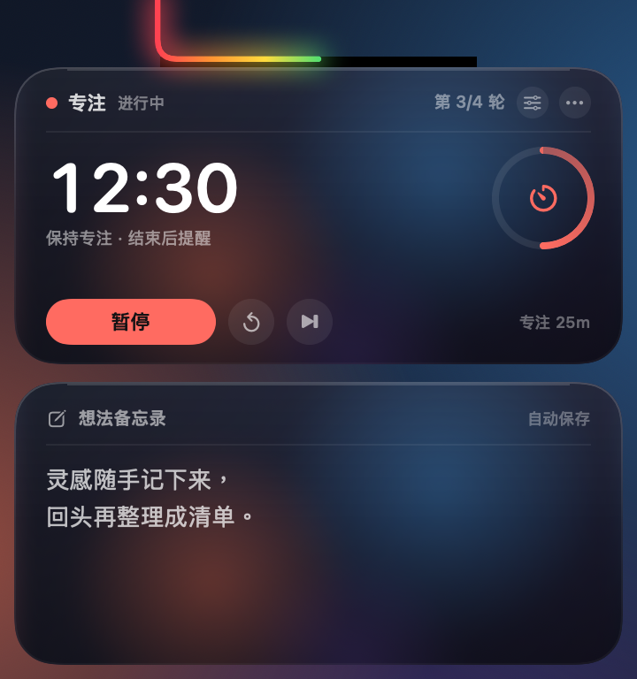
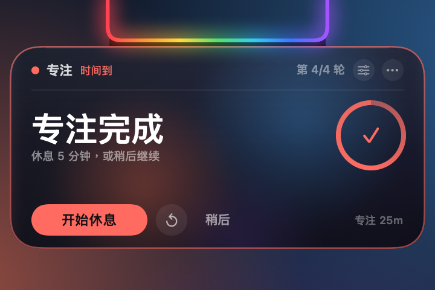
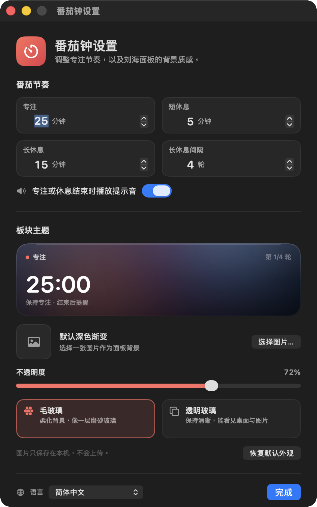

# 番茄钟 + 想法备忘录 · 刘海版

[English](README.md) · **简体中文** · [繁體中文](README.zh-TW.md) · [日本語](README.ja.md) · [한국어](README.ko.md) · [Español](README.es.md) · [Français](README.fr.md) · [Deutsch](README.de.md)

一个贴在 MacBook 刘海上的番茄钟 + 随手记小工具，界面支持 8 种语言。

> **只适用于带刘海的 MacBook。** 无刘海 Mac、外接显示器不是目标环境。


[](LICENSE)

平时，彩虹沿着刘海的左、下、右三条边环绕流动；一旦开始专注或休息，彩虹就变成倒计时进度条，从左到右慢慢填满。鼠标移到刘海处，它会向下展开：上方是番茄钟，下方是一块随时可以写的想法备忘录。专注或休息结束时，只会弹出计时卡片提醒你，不会把备忘录一起带出来。

## 兼容性

这个应用是为**带刘海的 MacBook** 设计的，不是普通菜单栏工具：

- 适用于 14/16 英寸 MacBook Pro（M1 Pro 及之后）和 13/15 英寸 MacBook Air（M2 及之后）等刘海屏机型
- 测试机：14 英寸 M4 芯片 MacBook，逻辑分辨率 1470×956，刘海宽度 179pt
- 系统要求：macOS 14 或更高
- 无刘海 Mac、外接显示器不是目标环境；代码里有兜底绘制，但布局和尺寸不保证
- 构建产物是 Universal（Apple Silicon + Intel），但实际目标机型是 Apple Silicon 刘海屏 Mac

**平时：彩虹沿着刘海的三个边环绕流动**


**展开：上方番茄钟，下方想法备忘录**



**专注结束：只弹计时卡片提醒**



> 展示图里是示例数据：专注 `12:30`（进度约一半）、今天第 3 轮，备忘录里是示例文字。收起图是**未开始**时的流动彩虹；展开图里彩虹填到一半，就是当前专注进度。

## 刘海彩虹进度条

- **没有计时（准备开始/空闲）**：保持原来的三边流动彩虹
- **专注、短休息、长休息倒计时**：彩虹变成进度条，从左到右填满 U 形刘海边缘
- **0%**：完全不画彩虹；**100%**：整条 U 形彩虹全部亮起
- **暂停**：停在当前进度
- **完成**：保持 100% 全彩虹（提醒时轻微呼吸）
- **重置/跳过**：回到准备状态，彩虹恢复流动
- 进度条使用实时进度计算，不是每秒跳一格；展开和收起的刘海都能看到

## 番茄钟

- 默认 **专注 25 分钟 / 短休息 5 分钟 / 长休息 15 分钟**
- 每完成 **4 轮**专注，自动进入一次长休息；间隔和三种时长都能在设置里改
- 大数字是当前阶段倒计时；右侧圆环显示本轮进度
- **开始专注 / 暂停 / 继续 / 重置本轮 / 跳过本轮**
- 顶部显示当前阶段、今天完成了多少轮；休息阶段会换成绿色或蓝色
- 专注和休息结束时会播放系统提示音（可在设置里关掉）
- 点 **⟳** 重置本轮，点 **⏭** 跳过本轮；跳过专注不会计入今日轮数

### 到点提醒

专注或休息结束后：

- 面板会自动展开，但**只显示计时卡片**，备忘录会暂时收起
- 卡片会出现彩色描边，刘海彩虹也会轻轻呼吸
- 专注结束显示「专注完成」，可以直接 **开始休息**，或点 **稍后**
- 休息结束显示「休息结束」，可以直接 **开始专注**
- 没有操作时约 20 秒后自动收回；鼠标停留在卡片上会保持展开
- 点「稍后」只会收起提醒，完成状态仍然保留；下次把鼠标移到刘海处，还能看到完成卡片并开始下一阶段
- 正在写备忘录时到点，会结束输入并切换到计时提醒，避免错过

## 想法备忘录

- 点击文字区域直接输入，支持多行、滚动、撤销 / 重做、复制粘贴
- 输入后约 0.4 秒自动保存，右上角显示「自动保存」
- 正在输入时面板不会自动收起；点击其他应用或桌面后才收回
- 清空：点卡片右上角 **⋯** → **清空备忘录…**（会二次确认），或在设置窗口里操作
- 备忘录和番茄钟、用时数据分开保存，重置统计不会清掉备忘

## 自定义板块主题

点计时卡片右上角的 **齿轮**，或 **⋯ → 外观与计时设置…**，打开设置窗口。



- **上传图片**：选择 PNG / JPEG / HEIC 等图片，会复制一份到应用数据文件夹，并把最长边压到 2400px，避免原图过大
- **不透明度**：8% – 100%，控制图片/玻璃层的通透程度；第一次选择图片会自动调到 80%
- **毛玻璃**：内置的柔光玻璃层，颜色柔和；自定义图片会被柔化，像隔着磨砂玻璃看图片
- **透明玻璃**：更清透，图片保持清晰，没有图片时会透出桌面
- 两种玻璃都会加一层深色保护，保证白字在明亮背景上仍然可读
- **移除图片** / **恢复默认外观** 随时可恢复
- 图片只保存在本机，不会上传，也不需要屏幕录制权限

> 毛玻璃使用内置的柔光层（以及柔化后的自定义图片），不会截取桌面内容；透明玻璃则会直接透出桌面或图片。想要“自己的桌面被柔化”的效果，可以把一张桌面截图/壁纸设为主题图片。

## 语言

界面支持 **8 种语言**：

- English（英语）
- 简体中文
- 繁體中文
- 日本語（日语）
- 한국어（韩语）
- Español（西班牙语）
- Français（法语）
- Deutsch（德语）

设置窗口左下角有地球图标和语言菜单：

- 默认「跟随系统」，自动使用 macOS 的首选语言
- 也可以手动指定语言，不受系统语言影响
- 切换后刘海面板、提醒卡片、右键菜单和设置窗口立即更新，不需要重启
- Finder 里显示的应用名称也会跟随系统语言（英文系统显示 `Notch Pomodoro`，中文系统显示「番茄钟」）

## 使用

- **展开**：鼠标移到刘海，或刘海下方那条彩虹上，约 0.12 秒后展开
- **保持**：鼠标移进卡片后保持展开；只是悬停不会抢走当前应用的键盘焦点
- **计时按钮**：点一下就会响应；按钮不会激活应用，也不会打断你正在用的软件
- **写备忘录**：点击备忘录会激活输入；写完点其他应用或桌面即可收起
- **收起**：鼠标离开卡片约 0.3 秒后收回成三边彩虹；正在输入备忘录时会保持展开
- **更多菜单**：点卡片右上角 **⋯**，或在计时卡片上右键
  - 开始 / 暂停 / 继续
  - 重置本轮、跳过本轮
  - 外观与计时设置
  - 登录时自动启动
  - 清空备忘录
  - 打开数据文件夹
  - 重置使用统计
  - 退出
- **临时展开**：在 Finder 中再次双击应用，卡片会展开约 4 秒
- 全屏应用、不同桌面下都能显示；卡片只在屏幕顶部，不占用 Dock

## 计时与提醒规则

- 番茄钟使用结束时间计算，不依赖每秒累加；系统卡顿或短暂休眠后不会明显漂移
- 专注结束会计入「今日专注」和长休息轮次；短休息结束不会增加轮数
- 长休息结束后，轮次重新从第 1 轮开始
- 跳过专注不增加轮数；跳过/完成长休息会重置轮次
- 今日专注轮数按本机时区自然日 0 点切分
- 倒计时在锁屏、休眠、切换应用时仍然继续；到点后会在刘海弹出提醒
- 电脑使用时长仍在后台记录（原功能保留），但顶部卡片不再显示；状态栏菜单和卡片菜单里可以看到「今日使用 / 累计使用」

## 数据与隐私

- 用时数据：`~/Library/Application Support/UsageClock/usage.json`
- 备忘录：`~/Library/Application Support/UsageClock/memo.txt`（输入后约 0.4 秒自动保存）
- 主题图片：`~/Library/Application Support/UsageClock/theme-image.png`（可选）
- 番茄钟设置、主题设置、语言设置：系统的 `UserDefaults`（`com.dumaster.usageclock`）
- 用时保存频率：约每 20 秒、锁屏/休眠时、退出时
- 不做分应用统计，不采集任何其他信息，也没有任何网络请求
- 重置用时 / 清空备忘录 / 移除主题图片都无法撤销

## 下载

在 [GitHub Releases](https://github.com/liutongqi0-star/notch-pomodoro/releases/latest) 下载最新的 `UsageClock.zip`，解压后把 `UsageClock.app` 拖进「应用程序」文件夹即可。首次打开如果提示无法验证开发者，右键点击应用 →「打开」。

也可以从源码构建，见下文。

## 安装

```bash
git clone https://github.com/liutongqi0-star/notch-pomodoro.git
cd notch-pomodoro
./install.sh
```

安装脚本会：

- 把 `UsageClock.app` 复制到 `~/Applications/`（当前用户目录，不需要管理员密码）
- 在 `~/Library/LaunchAgents/com.dumaster.usageclock.plist` 写入登录项，实现开机自启
- 立即启动应用

启动后，彩虹会环绕刘海流动；鼠标移上去就能看到番茄钟和备忘录。

## 卸载

```bash
./uninstall.sh          # 询问是否删除记录
./uninstall.sh --purge  # 连同记录一起删除
```

也可以手动删除：

```bash
rm -rf ~/Applications/UsageClock.app
rm -f ~/Library/LaunchAgents/com.dumaster.usageclock.plist
rm -rf "$HOME/Library/Application Support/UsageClock"   # 可选：删除记录、备忘和主题图片
```

## 从源码构建

要求：macOS 14 或更高版本、Xcode / Command Line Tools。

```bash
cd notch-pomodoro
./build.sh
```

脚本会用 `swiftc` 编译 Universal 二进制（Apple Silicon + Intel）、生成番茄红图标、做 ad-hoc 签名，并产出：

- `UsageClock.app`
- `build/UsageClock.zip`

想在不显示窗口的情况下渲染面板组件（调试或生成素材），可以运行：

```bash
mkdir -p /tmp/usageclock-preview
USAGECLOCK_RENDER_PREVIEW=1 \
USAGECLOCK_LANGUAGE=zh-Hans \
USAGECLOCK_DATA_DIR=/tmp/usageclock-preview \
USAGECLOCK_AGENT_DIR=/tmp/usageclock-preview \
USAGECLOCK_PREVIEW_DIR=/tmp/usageclock-preview \
./UsageClock.app/Contents/MacOS/UsageClock
```

会得到：

- `preview-cap.png`：三边彩虹光环
- `preview-body.png`：展开的番茄钟 + 备忘录
- `preview-reminder.png`：只显示计时卡片的到点提醒

界面翻译在 `Localization/*.json`；修改后运行 `python3 Tools/generate_localization.py` 重新生成 `Sources/L10nCatalog.swift`。

## 项目结构

```
UsageClock/
├── Sources/
│   ├── main.swift                  # 入口（含离线展示图渲染）
│   ├── AppDelegate.swift           # 应用生命周期、设置窗口、到点通知
│   ├── AppModel.swift              # 用时记录、状态检测、持久化
│   ├── PomodoroEngine.swift        # 番茄钟状态机、时长设置、长休息轮次
│   ├── PomodoroCard.swift          # 顶部番茄钟卡片
│   ├── Localization.swift          # 语言选择、文案查找、运行时切换
│   ├── L10nCatalog.swift           # 自动生成的翻译表
│   ├── ThemeModel.swift            # 主题图片、不透明度、玻璃类型
│   ├── ThemeView.swift             # 主题背景、玻璃层、设置预览
│   ├── SettingsView.swift          # 设置窗口内容
│   ├── SettingsWindowController.swift
│   ├── UsageStore.swift            # 用时 JSON 读写
│   ├── LoginItem.swift             # 登录项（LaunchAgent）
│   ├── TimeFormat.swift            # 时长/倒计时格式化
│   ├── MemoStore.swift             # 备忘录读写
│   ├── MemoEditor.swift            # 原生多行编辑器
│   ├── NotchGeometry.swift         # 刘海位置 / 面板尺寸 / 点击区域
│   ├── NotchView.swift             # 三边彩虹、展开卡片、流动动画
│   ├── NotchInteractionView.swift  # 悬停 / 按钮点击 / 右键菜单区域
│   ├── NotchController.swift       # 两个面板、展开收起、提醒态、菜单
│   └── StatusBarController.swift   # 菜单栏（备用入口）
├── Localization/                   # 8 种语言的文案 JSON
├── Resources/                      # 本地化的 InfoPlist.strings
├── Tools/
│   ├── MakeIcon.swift              # 生成 App 图标
│   ├── WindowID.swift              # 调试用：查询窗口编号
│   └── generate_localization.py    # 校验 JSON 并生成 L10nCatalog.swift
├── docs/                           # 展示图（英文版在 docs/en）
├── Info.plist
├── build.sh
├── install.sh
└── uninstall.sh
```

## 常见问题

**刘海处没有彩虹？**
确认应用正在运行（`pgrep -x UsageClock`）。如果这台 Mac 没有刘海，或主要在使用外接显示器，应用会在当前主屏幕顶部中间补一个黑色刘海形状和彩虹光环，悬停同样可以展开。

**为什么彩虹只亮了一部分？**
那是当前倒计时的进度：0% 完全不亮，100% 整条 U 形都亮。专注/休息结束时会到 100%；没有计时时才是完整流动的彩虹。

**到点提醒只出现一下就没了？**
没有操作时约 20 秒后会自动收回；鼠标停在卡片上会保持。点「稍后」也会收起提醒，但完成状态还在，重新悬停可以看到并开始下一阶段。

**为什么毛玻璃没有把桌面模糊掉？**
毛玻璃使用的是内置柔光层和柔化后的自定义图片，不读取桌面内容，所以不需要屏幕录制权限；透明玻璃会直接透出桌面。如果你想要“自己桌面被柔化”的效果，可以把桌面截图或壁纸上传为主题图片。

**透明玻璃上文字看不清楚？**
透明玻璃更通透，背景复杂时可以把「不透明度」调高，或改用毛玻璃/带图片的主题。设置里会实时预览。

**备忘录会自动收起吗？**
不会。只要你点击了备忘录并处于输入状态，面板会一直展开；点到其他应用或桌面后才会收起。如果只是悬停查看、没有点击，鼠标移开约 0.3 秒后就会收起。

**备忘录/主题图片存在哪里？**
`~/Library/Application Support/UsageClock/` 下的 `memo.txt` 和 `theme-image.png`。想清空备忘录可以点 ⋯ → 清空备忘录；主题图片可以在设置里移除。

**原来的总使用时长去哪了？**
顶部卡片已经换成番茄钟；电脑使用时长仍在后台记录。打开 ⋯ 菜单或状态栏菜单，可以看到「今日使用 / 累计使用」，也可以重置使用统计。

**菜单栏的图标看不到？**
带刘海的 Mac 在菜单栏项目较多时，系统会把新图标放到刘海下面，导致完全不可见。这不影响使用，刘海上的彩虹和悬停面板就是主界面；想恢复图标可以关掉一些不常用的菜单栏项目。

**登录时自动启动没有生效？**
确认 `~/Library/LaunchAgents/com.dumaster.usageclock.plist` 存在；如果手动移动过应用，先运行一次应用，它会自动更新登录项里的路径。也可以在 ⋯ 菜单里关闭再打开一次「登录时自动启动」。

**首次打开提示「无法验证开发者」？**
应用是本地 ad-hoc 签名的。在 Finder 中右键点击 `UsageClock.app` →「打开」，或在终端执行：

```bash
xattr -dr com.apple.quarantine ~/Applications/UsageClock.app
```

---

当前版本：**3.2.0（build 12）**

仓库：<https://github.com/liutongqi0-star/notch-pomodoro>

## License

MIT License. 详见 [LICENSE](LICENSE)。
