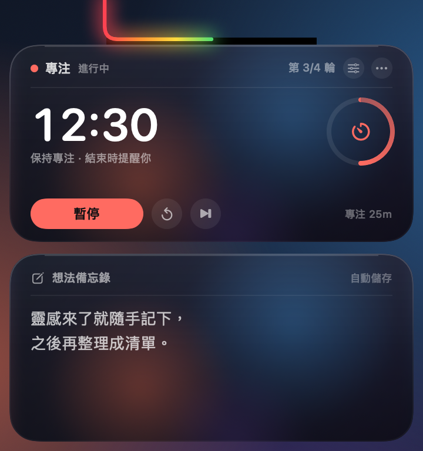
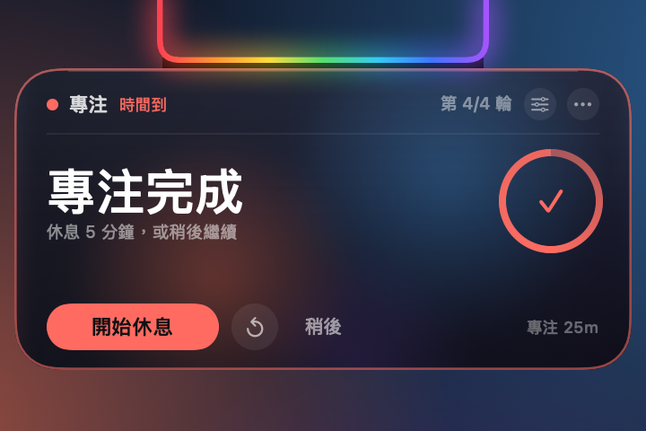
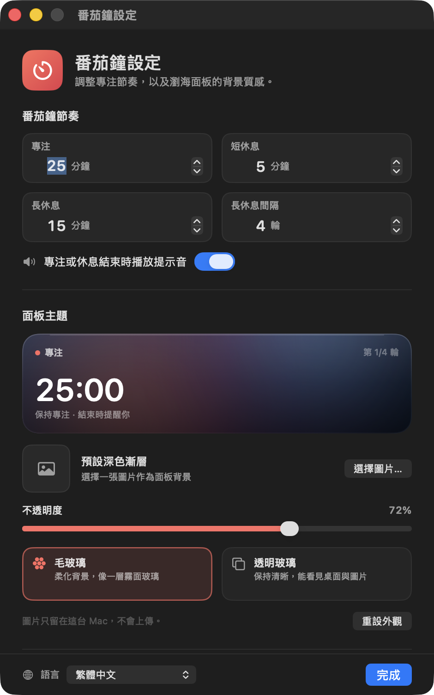

# 瀏海番茄鐘 + 想法備忘錄

[English](README.md) · [简体中文](README.zh-CN.md) · **繁體中文** · [日本語](README.ja.md) · [한국어](README.ko.md) · [Español](README.es.md) · [Français](README.fr.md) · [Deutsch](README.de.md)

一個棲息在 MacBook 瀏海上的番茄鐘與隨手記備忘錄。專注或休息進行期間，瀏海周圍的彩虹會變成倒數進度條。

> **僅適用於配備瀏海的 MacBook。** 沒有瀏海的 Mac 與外接螢幕並非支援的目標環境。


[](LICENSE)

閒置時，彩虹會沿著瀏海的左、下、右三邊流動。開始專注或休息後，彩虹就變成進度條，由左至右填滿 U 形邊框。將指標移到瀏海上即可展開：上方是計時器，下方是備忘錄。時段結束時只會出現計時卡片，備忘錄不會跟著跑出來。

## 相容性

這個應用程式是專為**配備瀏海的 MacBook** 打造，並非通用的選單列計時器：

- 14/16 吋 MacBook Pro（M1 Pro 及後續機型）與 13/15 吋 MacBook Air（M2 及後續機型）
- 實測機型為 14 吋 M4 MacBook，邏輯解析度 1470×956，瀏海寬度 179 pt
- macOS 14 或以上版本
- 沒有瀏海的 Mac 與外接螢幕並非目標環境；程式仍備有備援繪製，但版面配置與尺寸不保證正確
- 執行檔為 Universal 版本（Apple Silicon + Intel），但預定硬體為 Apple Silicon 的瀏海 MacBook

**閒置：彩虹沿著瀏海流動**


**展開：上方是計時器，下方是想法備忘錄**



**時段結束：僅顯示計時卡片的提醒**



> 展示圖使用範例資料：專注 `12:30`（進度約一半）、今日第 3 輪，以及範例備忘錄文字。閒置示意圖呈現時段開始前的流動彩虹；展開示意圖中彩虹已填滿一半，對應當下的專注進度。

## 彩虹就是進度條

- **沒有進行中的倒數（準備開始／閒置）**：維持原本沿三邊流動的彩虹
- **專注、短休息或長休息進行中**：彩虹變成進度條，由左至右填滿瀏海的 U 形邊框
- **0%**：完全不顯示彩虹；**100%**：整條 U 形邊框亮起
- **已暫停**：進度條停在目前位置
- **完成**：維持 100%，並在提醒期間輕輕脈動
- **重設／跳過**：回到準備開始狀態，流動彩虹也會回來
- 進度依實際結束時間計算，因此會平順移動，而不是每秒跳一格；收起與展開狀態都看得到

## 番茄鐘

- 預設為**專注 25 分鐘／短休息 5 分鐘／長休息 15 分鐘**
- 每 **4 輪專注**進入一次長休息；三種時長與間隔皆可設定
- 大字為目前的倒數；右側圓環顯示本輪進度
- **開始專注／暫停／繼續／重設本輪／跳過本輪**
- 標題列顯示目前階段與今日已完成的輪數；休息階段會切換為綠色或藍色
- 專注或休息結束時播放系統音效（可關閉）
- **⟳** 重設本輪；**⏭** 跳過本輪。跳過專注不會計入今日輪數

### 階段結束提醒

- 面板會自動展開，但**只顯示計時卡片**；備忘錄卡片會暫時隱藏
- 卡片會出現彩色邊框，瀏海彩虹也會脈動
- 專注結束顯示「專注完成」：可立即開始休息，或選擇**稍後**
- 休息結束顯示「休息結束」：可立即開始下一次專注
- 若未進行任何操作，提醒約 20 秒後收起；指標停留在卡片上則保持展開
- **稍後**只會關閉提醒；完成狀態仍會保留，之後將指標移到瀏海時卡片會再次出現
- 若時間到時正在輸入備忘錄，輸入會結束並由提醒接手，以免錯過

## 想法備忘錄

- 點按文字區域即可輸入；支援多行、捲動、復原／重做與複製貼上
- 停止輸入約 0.4 秒後自動儲存，右上角會顯示「自動儲存」
- 輸入期間面板會保持展開；點按其他應用程式或桌面後才會收起
- 可從 **⋯ → 清除備忘錄…**（會再次確認）或設定視窗清除
- 備忘錄與使用資料分開儲存，因此重設使用統計不會刪除備忘錄

## 面板主題

從計時卡片上的**齒輪**圖示，或 **⋯ → 外觀與計時設定…** 開啟設定。



- **自訂圖片**：選擇 PNG／JPEG／HEIC 圖片。圖片會複製到應用程式的資料資料夾，並將最長邊縮放至 2400 px，原始檔案不會被更動
- **不透明度**：8%–100%，控制圖片與玻璃層的透出程度；第一次選擇圖片時會自動提高到 80%
- **毛玻璃**：內建的柔光玻璃層；自訂圖片會被柔化，就像隔著毛玻璃觀看
- **透明玻璃**：更通透，圖片保持清晰；未設定圖片時會透出桌面
- 兩種樣式都會加上一層深色保護層，讓白色文字在明亮背景上依然清晰可讀
- **移除圖片**／**重設外觀**可隨時恢復預設值
- 圖片只會留在這台 Mac，絕不會上傳，也不需要螢幕錄製權限

> 毛玻璃模式使用內建的柔光層（加上柔化後的自訂圖片），不會擷取桌面內容。透明玻璃模式則直接透出桌面或圖片。若想要「自己的桌面被柔化」的效果，可將桌面截圖或桌布設為主題圖片。

## 語言

介面提供 **8 種語言**：

- English（英文）
- 简体中文（簡體中文）
- 繁體中文
- 日本語（日文）
- 한국어（韓文）
- Español（西班牙文）
- Français（法文）
- Deutsch（德文）

選擇**跟隨系統**即可沿用 macOS 的語言設定，或從設定視窗左下角的地球選單手動選擇語言。變更會立即套用到面板、提醒、右鍵選單與設定視窗，不需要重新啟動。Finder 中顯示的名稱也會跟隨系統語言。

## 使用方式

- **展開**：將指標移到瀏海，或移到瀏海下方的彩虹條；約 0.12 秒後展開
- **保持展開**：指標移入卡片後就會保持展開；單純懸停不會搶走目前應用程式的鍵盤焦點
- **計時按鈕**：第一次點按就會回應，不會啟用應用程式，也不會打斷你正在做的事
- **撰寫備忘錄**：點按備忘錄區域即可開始輸入；完成後點按其他應用程式或桌面
- **收起**：指標離開卡片約 0.3 秒後收起；輸入備忘錄期間會保持展開
- **更多選單**：點按卡片上的 **⋯**，或在計時卡片上按右鍵
  - 開始／暫停／繼續
  - 重設本輪、跳過本輪
  - 外觀與計時設定
  - 登入時自動啟動
  - 清除備忘錄
  - 開啟資料資料夾
  - 重設使用統計
  - 結束
- **暫時顯示**：在 Finder 中再次連按兩下應用程式，卡片會展開約 4 秒
- 在全螢幕應用程式與不同桌面空間都能運作；卡片固定在螢幕頂端，不佔用 Dock 空間

## 計時與提醒規則

- 番茄鐘以結束時間計算，而不是每秒累加，因此系統卡頓或短暫休眠後不會明顯偏移
- 完成專注會計入「今日」與長休息循環；完成短休息不會增加輪數
- 長休息結束後，輪數會重新從 1 開始
- 跳過專注不會增加輪數；跳過或完成長休息都會重設循環
- 今日專注輪數會在本機時間的午夜換日
- 倒數在螢幕鎖定、休眠與切換應用程式時仍會繼續；時間到時瀏海會出現提醒
- 電腦使用時間仍會在背景記錄（原有功能）。頂部卡片已不再顯示，可從選單列或卡片選單查看「今日使用／累計使用」

## 資料與隱私

- 使用資料：`~/Library/Application Support/UsageClock/usage.json`
- 備忘錄：`~/Library/Application Support/UsageClock/memo.txt`（輸入後約 0.4 秒自動儲存）
- 主題圖片：`~/Library/Application Support/UsageClock/theme-image.png`（選用）
- 番茄鐘與主題設定：系統 `UserDefaults`（`com.dumaster.usageclock`）
- 使用資料約每 20 秒儲存一次，並在螢幕鎖定／休眠與結束時儲存
- 不追蹤個別應用程式、不蒐集任何其他資訊，也沒有任何網路請求
- 重設使用資料／清除備忘錄／移除主題圖片皆無法復原

## 下載

從 [GitHub Releases](https://github.com/liutongqi0-star/notch-pomodoro/releases/latest) 下載最新的 `UsageClock.zip`，解壓縮後將 `UsageClock.app` 拖曳到「應用程式」資料夾。若首次啟動時 macOS 提示無法驗證開發者，請在應用程式上按右鍵 → **打開**。

也可以從原始碼自行建置（見下文）。

## 安裝

```bash
git clone https://github.com/liutongqi0-star/notch-pomodoro.git
cd notch-pomodoro
./install.sh
```

安裝腳本會：

- 將 `UsageClock.app` 複製到 `~/Applications/`（目前使用者，不需管理員密碼）
- 在 `~/Library/LaunchAgents/com.dumaster.usageclock.plist` 寫入登入項目，以便登入時自動啟動
- 立即啟動應用程式

啟動後，彩虹會沿著瀏海流動；將指標移上去就能看到計時器與備忘錄。

## 解除安裝

```bash
./uninstall.sh          # asks whether to delete recorded data
./uninstall.sh --purge  # also deletes recorded data
```

或手動移除：

```bash
rm -rf ~/Applications/UsageClock.app
rm -f ~/Library/LaunchAgents/com.dumaster.usageclock.plist
rm -rf "$HOME/Library/Application Support/UsageClock"   # optional: usage, notes, theme image
```

## 從原始碼建置

需求：macOS 14 或以上版本、Xcode／Command Line Tools。

```bash
cd notch-pomodoro
./build.sh
```

腳本會以 `swiftc` 編譯 Universal 二進位檔（Apple Silicon + Intel）、產生番茄圖示、套用 ad-hoc 簽章，並產出：

- `UsageClock.app`
- `build/UsageClock.zip`

若要在不顯示視窗的情況下渲染面板元件（用於產生素材或除錯）：

```bash
mkdir -p /tmp/usageclock-preview
USAGECLOCK_RENDER_PREVIEW=1 \
USAGECLOCK_LANGUAGE=en \
USAGECLOCK_DATA_DIR=/tmp/usageclock-preview \
USAGECLOCK_AGENT_DIR=/tmp/usageclock-preview \
USAGECLOCK_PREVIEW_DIR=/tmp/usageclock-preview \
./UsageClock.app/Contents/MacOS/UsageClock
```

會產生：

- `preview-cap.png`：三邊彩虹
- `preview-body.png`：展開的計時器 + 備忘錄
- `preview-reminder.png`：僅顯示計時卡片的提醒

介面翻譯位於 `Localization/*.json`；編輯後請執行 `python3 Tools/generate_localization.py` 重新產生 `Sources/L10nCatalog.swift`。

## 專案結構

```
UsageClock/
├── Sources/
│   ├── main.swift                  # entry point (+ offline preview rendering)
│   ├── AppDelegate.swift           # lifecycle, settings window, completion notifications
│   ├── AppModel.swift              # usage tracking, state detection, persistence
│   ├── PomodoroEngine.swift        # timer state machine, durations, long-break cycle
│   ├── PomodoroCard.swift          # top timer card
│   ├── Localization.swift          # language selection, lookup, runtime switching
│   ├── L10nCatalog.swift           # generated translation tables
│   ├── ThemeModel.swift            # theme image, opacity, glass style
│   ├── ThemeView.swift             # card background, glass layers, settings preview
│   ├── SettingsView.swift          # settings window content
│   ├── SettingsWindowController.swift
│   ├── UsageStore.swift            # usage JSON
│   ├── LoginItem.swift             # login item (LaunchAgent)
│   ├── TimeFormat.swift            # duration/countdown formatting
│   ├── MemoStore.swift             # memo persistence
│   ├── MemoEditor.swift            # native multiline editor
│   ├── NotchGeometry.swift         # notch position / panel sizes / hit areas
│   ├── NotchView.swift             # rainbow, expanded card, animation
│   ├── NotchInteractionView.swift  # hover / button clicks / context menu
│   ├── NotchController.swift       # panels, expand/collapse, reminder state, menu
│   └── StatusBarController.swift   # menu bar (secondary entry point)
├── Localization/                   # en, zh-Hans, zh-Hant, ja, ko, es, fr, de
├── Resources/                      # localized InfoPlist.strings
├── Tools/
│   ├── MakeIcon.swift              # app icon generator
│   ├── WindowID.swift              # debug helper: list window IDs
│   └── generate_localization.py    # validates JSON and generates L10nCatalog.swift
├── docs/                           # screenshots (docs/en for English)
├── Info.plist
├── build.sh
├── install.sh
└── uninstall.sh
```

## 常見問題

**瀏海處沒有彩虹？**
請確認應用程式正在執行（`pgrep -x UsageClock`）。若這台 Mac 沒有瀏海，或你主要使用外接螢幕，應用程式會在目前主螢幕頂端中央繪製黑色瀏海造型與彩虹；將指標移上去同樣可以展開。

**為什麼彩虹只亮了一部分？**
那是目前的倒數進度：0% 完全不亮，100% 會點亮整條 U 形邊框。專注／休息結束時會達到 100%；完整流動的彩虹僅屬於閒置狀態。

**提醒一下子就消失了。**
若未進行任何操作，約 20 秒後就會收起；指標停留在卡片上則會保持展開。**稍後**也會關閉提醒，但完成狀態仍會保留；再次將指標移到瀏海，就能看到卡片並開始下一個階段。

**為什麼毛玻璃沒有把我的桌面模糊掉？**
毛玻璃模式使用內建柔光層與柔化後的自訂圖片，並不會讀取桌面內容，因此不需要螢幕錄製權限；透明玻璃模式則直接透出桌面。若想要「自己的桌面被柔化」的效果，請將桌面截圖或桌布上傳為主題圖片。

**透明玻璃上的文字看不清楚。**
透明玻璃模式較為通透；可提高**不透明度**、改用毛玻璃，或使用帶圖片的主題。設定視窗提供即時預覽。

**備忘錄面板會自動收起嗎？**
不會。一旦點進備忘錄並開始輸入，面板會持續展開，直到你點按其他應用程式或桌面為止。若只是懸停查看，指標離開約 0.3 秒後就會收起。

**備忘錄與主題圖片儲存在哪裡？**
位於 `~/Library/Application Support/UsageClock/` 下的 `memo.txt` 與 `theme-image.png`。想清空備忘錄，可選擇 ⋯ → 清除備忘錄；主題圖片則可在設定中移除。

**原本的累計使用時間跑到哪裡了？**
頂部卡片現在是番茄鐘；電腦使用時間仍會在背景記錄。開啟 ⋯ 選單或選單列上的選單，即可查看「今日使用／累計使用」，也能重設使用統計。

**選單列圖示看不見。**
在配備瀏海的 Mac 上，當選單列項目太多時，macOS 可能會把狀態項目藏到瀏海下方。這不影響應用程式：瀏海彩虹與懸停面板才是主要介面。移除幾個較少使用的選單列項目即可讓它回來。

**登入時自動啟動沒有作用。**
請確認 `~/Library/LaunchAgents/com.dumaster.usageclock.plist` 存在。若曾手動移動應用程式，請先啟動一次，讓它更新路徑。也可以在 ⋯ 選單中將「登入時自動啟動」關閉後再開啟一次。

**首次啟動出現「無法驗證開發者」。**
應用程式是在本機以 ad-hoc 方式簽署。在 Finder 中於 `UsageClock.app` 上按右鍵 → **打開**，或執行：

```bash
xattr -dr com.apple.quarantine ~/Applications/UsageClock.app
```

---

目前版本：**3.2.0（build 12）**

儲存庫：<https://github.com/liutongqi0-star/notch-pomodoro>

## 授權

MIT License，詳見 [LICENSE](LICENSE)。
